# 03 用户旅程：Windows 本地客户端用户

第一阶段草案（2026-11-03，检查点 1 后修订）。首版只支持 Windows 本地客户端（[06 第 1.1 节](06-proposals-and-phase2.md#11-首版范围调整2026-11-03-用户决定)），本文是首版旅程的唯一正文。画像见 [README](README.md#用户画像与范围)。功能编号 `F-xx` 见 [01](01-functions.md)，约束编号 `C-xx` 见 [02](02-constraints.md)，提案编号 `P-xx` 见 [06](06-proposals-and-phase2.md#1-功能提案)，各步骤的状态细节见 [05](05-state-matrix.md)。

## 写法说明

- **触点**：窗口（youkai 主窗口）、托盘（通知区域图标及其菜单）、通知（P-06 的结束通知或托盘气泡）、热键（全局停止热键）、游戏（《绝区零》客户端窗口）、系统（安装器、UAC、资源管理器等系统界面）。
- **情绪**：1（沮丧）到 5（顺畅）。Mermaid `journey` 图中的分数即此值，是设计判断，不是测量结果。
- **优先级**说的是“首版必须把这项能力做到什么程度”：P0 = 首版必须顺畅，否则主流程走不通；P1 = 高风险或常见，应在首版处理好；P2 = 低频，可以简单处理。
- **优先级不等于显著性。** 显著性说的是“这一步是否出现在每次的主路径上、在界面上多突出”，由主干决定（见下节）。例如 W3 校对是 P0 能力，但只在有待校对项或用户主动检查时才进入主路径；W6 清理是 P2，但磁盘不足阻止开始扫描时，它必须是准备检查里直接可达的出口。第二阶段不能把“必须支持”读成“必须突出”。
- **使用频率未知。** 用户认为无法假设扫描、校对、导出的频率（[06 第 1.2 节](06-proposals-and-phase2.md#12-其他产品决定2026-11-03)）。旅程不按频率排序，首次与回访两条路径都要高效。
- 标注“P-xx 已决定”的步骤按 2026-11-03 的决定来写；展示与导航条款已于 2026-11-05 同步（见 [12](12-implementation-plan.md)），数据与流程契约由各服务层 PR 同步。截图处理按 P-13（已决定）：默认保留，扫描结束时不询问；T6 §1 的对应条款（及架构 §5 清理约束第 1 条）已同步为 P-13（实现状态：随 PR-13 落地）。
- 旅程只描述“做什么、在哪里、感觉如何”，不描述布局。

## 旅程一览

**主干：** 回访 → 准备检查 → 扫描 → 结果摘要 →（有待校对项或用户主动检查时）校对 → 导出。首次使用是汇入准备检查的支线。

| 编号 | 旅程 | 优先级 | 在主干上的位置 | 对应功能 |
| --- | --- | --- | --- | --- |
| W5a | 回访：打开最近一条记录 | P0 | 主干起点（回访） | F-24、F-25 |
| W1 | 首次使用：安装、权限与环境准备 | P0 | 支线，汇入准备检查 | F-01–F-05、F-07、F-08、F-36 |
| W2 | 扫描：准备检查 → 进行 → 结果摘要 / 失败 | P0 | 主干 | F-06–F-15、F-36–F-39 |
| W3 | 校对 | P0（能力） | 主干上的条件分支 | F-16–F-21 |
| W4 | 导出 | P0 | 主干终点 | F-22、F-23 |
| W5b | 历史列表与筛选 | P1 | 主干外 | F-24、F-25 |
| W6 | 清理 | P2（磁盘不足时是主干出口） | 主干外 | F-15、F-26、F-27 |
| W7 | 设置与更新 | P2（更新受阻时 P1） | 主干外 | F-28–F-31、F-39 |
| W8 | 托盘与退出 | P1 | 贯穿全程 | F-32–F-35 |

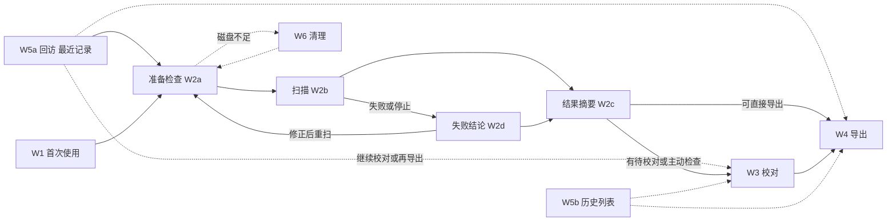

准备检查不通过、准备超时或扫描失败后，都回到准备检查修正条件再开始（W2 流程图）；不会退回 W1。设置与更新（W7）、托盘与退出（W8）不在主干上，任何时候都可进入。

## W5a 回访：打开最近一条记录

**用户目标：** 打开 youkai 时，立刻知道上次扫描的状态，并决定下一步：再扫一次、继续校对，还是再导出。

**触发：** 再次启动 youkai（含从托盘恢复、再次双击图标）。

| # | 步骤 | 触点 | 用户在想什么 | 情绪 | 痛点风险 |
| --- | --- | --- | --- | --- | --- |
| 1 | 启动 youkai | 窗口 | “上次扫到哪了？” | 4 | 首屏只为首次使用优化时，回访者要多走一步才能看到上次结果；反之亦然（使用频率未知，两种都要高效）。 |
| 2 | 看到最近一条记录的状态：日期、覆盖、待校对数、可导出数 | 窗口 | “上次扫全了吗？” | 4 | 只显示“完成”会误导（C-26）。 |
| 3 | 选择：再扫一次（→ W2-R）、继续校对（→ W3）、再导出（→ W4） | 窗口 | “库存变了，再扫一次。” | 4 | 再扫生成新记录，不覆盖旧记录；用户可能以为会“更新”上一条记录。 |

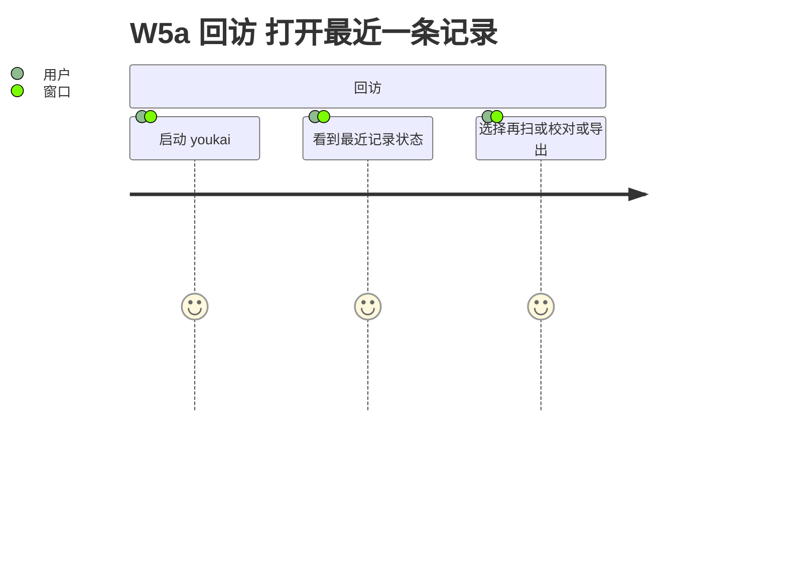

**边缘路径：** 最近一条记录损坏或不可读（P1，见 S9）；最近一条是中断记录（P1：只能查看与校对，F-25）；没有任何记录（即首次使用，转 W1）。

## W1 首次使用：安装、权限与环境准备

**用户目标：** 装好 youkai，确认“我的电脑和游戏能用它扫描”，在第一次扫描前把需要调整的地方一次调好。

**触发：** 下载安装包后第一次打开；或换了电脑后第一次使用。

游戏通常以管理员权限运行（[README 画像](README.md#用户画像与范围)），普通双击打开的 youkai 在权限检查上一定不通过（C-10）。因此**提权是首次使用主路径的正常步骤**，在准备检查里提前发现并引导，不靠“点开始失败”来教会用户。

| # | 步骤 | 触点 | 用户在想什么 | 情绪 | 痛点风险 |
| --- | --- | --- | --- | --- | --- |
| 1 | 运行安装包（F-01） | 系统 | “这个安装包安全吗？” | 3 | 未签名，SmartScreen 可能拦截（C-14）；用户不知道是否该继续。 |
| 2 | 第一次打开 youkai，看到准备检查清单（P-03 已决定） | 窗口 | “接下来要做什么？” | 3 | 清单首次要解释每一项为什么需要；条件来自 C-07、C-10、C-11、C-12、C-04。 |
| 3 | 准备检查显示权限不一致：游戏是管理员，youkai 不是 | 窗口 | “为什么要管理员？安全吗？” | 3 | 文案要说明只发送鼠标输入、不加载驱动、不注入、不读内存（C-10）。 |
| 4 | 按引导“先从托盘退出 youkai，再以管理员身份运行”（P-05 已决定） | 托盘、系统 | “退出了吗？” | 3 | 只点 × 是隐藏（C-20），旧实例还在托盘里；不先退出，再次启动会被转交给旧实例，提权无效（C-22，提权后的单实例行为未实测）。一键提权先实测（P-05）。 |
| 5 | 以管理员身份重新打开，UAC 确认 | 系统、窗口 | “这次应该可以了。” | 3 | 提权后的深链接与自动更新未实测（C-10）。 |
| 6 | 准备检查逐项调整：游戏设为 1920×1080 窗口或无边框模式，放在屏幕内，打开驱动盘仓库页（F-06） | 游戏、窗口 | “调好了吗？” | 3 | 单显示器下 youkai 与 1920×1080 游戏窗口无法并排，用户要来回切换；清单要显示“当前值 → 需要值”，例如“当前 2560×1440 → 需要 1920×1080”（P-03）。 |
| 7 | 准备检查全部通过，汇入 W2 | 窗口 | “可以开始了。” | 4 | — |

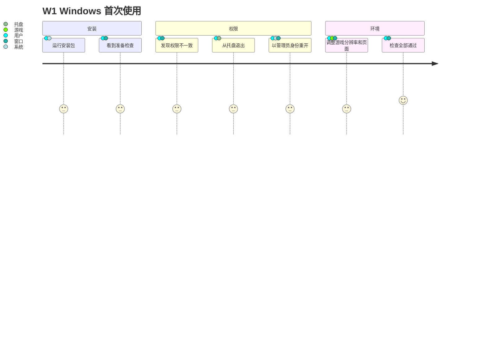

**主路径：** 1 → 7（游戏以管理员运行的常见情况）。游戏未提权或 youkai 已以管理员身份运行时，跳过 3–5。

**边缘路径：**

| 路径 | 说明 | 优先级 |
| --- | --- | --- |
| E1 权限查询失败 | `integrityUnverifiable`，按拒绝处理，同样引导以管理员身份运行（C-10）。 | P1 |
| E2 分辨率不受支持 | 已知未开放档位与未知尺寸分别提示，都要写出“请切到 1920×1080 窗口或无边框模式”（C-11）。 | P0 |
| E3 窗口超出工作区或独占全屏 | 4K 屏上窗口被任务栏裁掉、跨屏、独占全屏（C-12）；独占全屏要到开始后才能检查。 | P0 |
| E4 停止热键被占用 | 热键注册失败不能开始（C-04）；规格要求可自定义（[T2 §2.2](../../specs/t2-platform-capture-input.md#22-macosscreencapturekit-窗口流与-quartz-输入) 第 85 行），实现排在 M3，当前不能改键（D-10）。 | P1 |
| E5 SmartScreen / Smart App Control 拦截 | 系统层面，youkai 无法在应用内处理，只能在下载页或说明中告知（C-14）。 | P2 |
| E6 资源缺失或损坏 | 安装不完整时识别资源报错（F-05）。 | P2 |
| E7 DPI 检查不通过 | 故障码 `dpiAwarenessMismatch`、`dpiVirtualized`、`dpiCheckUnavailable`；当前没有中文提示（D-04）。只有 125% 缩放有实测证据，其他缩放未验证（推断，[T2 §3.2](../../specs/t2-platform-capture-input.md#32-可验收的窄显示配置候选)）。 | P1 |
| E8 找不到游戏 | 游戏未启动或没有合格窗口；准备检查说明需要先启动游戏并打开仓库页（P-01）。 | P0 |

## W2 扫描

**用户目标：** 把驱动盘仓库完整、可信地扫一遍，过程中不用盯着，结束后知道结果是否可信、能不能直接导出。

**触发：** 首次使用（来自 W1），或回访时库存有变化（W2-R，来自 W5a）。

**W2-R 回访再扫：** 与首次扫描走同一条路径，差异只在入口与结果：从扫描页进入准备检查；回访查看上次结果走记录列表首行（[08 §5](08-screens.md#5-记录列表历史)）；每次仍完整重查条件（准备检查的旧结果不能当作通过，P-03）；完成后生成一条新记录，不覆盖旧记录。这是主干上的 P0 路径，不是新功能。**实现状态：随 PR-10、PR-12 落地。**

### W2a 准备检查与开始

| # | 步骤 | 触点 | 用户在想什么 | 情绪 | 痛点风险 |
| --- | --- | --- | --- | --- | --- |
| 1 | 在游戏中打开驱动盘仓库页（F-06） | 游戏 | “要先设置筛选吗？” | 4 | 用户可能以为要手动设置筛选或排序；实际扫描器会自己做，但不碰排序（C-07；T6 §1 的不同说法见 D-12）。 |
| 2 | 切到 youkai，看准备检查：目标客户端（P-01 已决定，唯一候选也显示供确认）、各项“当前值 → 需要值”（P-03 已决定） | 窗口 | “它找到我的游戏了吗？都满足了吗？” | 4 | 当前安装版没有扫描源（D-01）。磁盘不足时直接给出清理入口（→ W6）。 |
| 3 | 记住停止热键、30 秒规则，看到预计耗时（P-14 已决定；没有历史时写“未知”） | 窗口 | “中途想停怎么办？要多久？” | 3 | 当前界面没有显示 30 秒和实际热键（D-02）。 |
| 4 | 点开始（F-09）；youkai 窗口留在原地（P-09 不采纳），程序请求把游戏切到前台 | 窗口 | “开始了。” | 4 | 点开始后仍按规格完整预检，失败立刻返回原因（F-08）。 |
| 5 | 游戏切到前台；倒计时在 youkai 上（P-04 已决定），但游戏在前台时用户看不到 | 游戏 | “要我自己切吗？” | 3 | 激活可能被系统拒绝，用户需要自己 Alt+Tab（C-05）；遮挡、独占全屏、纯黑画面检查在这时才进行，失败原因到期后才显示（L-02；实时原因先实测，P-04）。 |

### W2b 进行：扫描中没有反馈

按明确的设计假设，扫描期间用户收不到任何 youkai 反馈（[06 第 3 节第 1 条](06-proposals-and-phase2.md#3-给第二阶段的输入)）。

| # | 步骤 | 触点 | 用户在想什么 | 情绪 | 痛点风险 |
| --- | --- | --- | --- | --- | --- |
| 6 | 看着游戏被自动操作（转盘、筛选、回顶、逐件点选） | 游戏 | “它在正常工作吗？” | 4 | 用户只能从游戏画面判断进度（C-01、C-03）。 |
| 7 | 等待，不去碰 youkai | 游戏 | “还要多久？” | 3 | 总数未知，不显示百分比（C-09）；开始前的预计耗时是唯一的时间参考（P-14）。打开主窗口会停止扫描（C-03）；托盘悬停或菜单状态是否会停止扫描未测（Windows 只验证了空闲态托盘，见 [Windows 托盘诊断报告](../../reports/2026-11-03-windows-tray-diagnosis.md)第 17、21 行），实测通过前不作为反馈渠道（P-02）。 |
| 8 | 自动恢复（某位置未完成，继续下一位置） | 游戏 | “刚才是不是出错了？” | 3 | 恢复不打断扫描（C-08），用户在结束通知或结果摘要里才知道有位置不完整。 |

### W2c 结束（正常）：结果摘要

| # | 步骤 | 触点 | 用户在想什么 | 情绪 | 痛点风险 |
| --- | --- | --- | --- | --- | --- |
| 9 | 输入停止、进入收尾时收到第一条通知：扫描已停止操作、正在收尾（P-06 已决定；不支持系统通知时为托盘气泡） | 通知、游戏 | “结束了吗？” | 4 | 通知只在输入停止后发出；点击通知只打开 youkai，不启动扫描。 |
| 10 | 收尾结束时收到结果通知：已保存时写明结束类型、覆盖结论、待校对数；保存失败时写明失败与需要重试（F-13） | 通知、窗口 | “数据保存了吗？” | 4 | 保存失败也必须发通知，否则用户收不到唯一的反馈；收尾可能需要一段时间结束识别。 |
| 11 | 看到结果摘要：覆盖、待校对数、有警告件数、可导出数（F-14） | 窗口 | “能直接导出吗？” | 4 | 只看到“完成”会误导（C-26）；警告件可直接导出，不能被当成待校对（[06 第 1.2 节](06-proposals-and-phase2.md#12-其他产品决定2026-11-03)）。 |
| 12 | 截图默认保留，结束时不询问（P-13 已决定，F-15）；需要时之后在校对后、导出后或清理页删除 | 窗口 | “截图会留着，之后再说。” | 4 | 删除入口要在用户校对、导出之后能找到（W6）；T6 §1 的对应条款（及架构 §5 清理约束第 1 条）已同步为 P-13（2026-11-05；实现状态：随 PR-13 落地）。 |
| 13 | 有待校对项或想主动检查 → W3；否则直接 → W4 | 窗口 | — | 4 | 11-02 真机全量 1,017 件中只有 1 件待校对（[真机报告](../../reports/2026-11-02-windows-local-field-acceptance.md)第 62 行），直接导出是常见出口，不是边缘路径。 |

### W2d 失败或用户停止

| # | 步骤 | 触点 | 用户在想什么 | 情绪 | 痛点风险 |
| --- | --- | --- | --- | --- | --- |
| 14 | 扫描意外停止（失焦、遮挡、页面失效、几何变化、3 个位置不完整等）；先收到“已停止操作、正在收尾”的通知，失败原因在收尾结束后的第二条结果通知里（P-06、F-37） | 通知、游戏 | “怎么停了？” | 2 | 不支持系统通知又没有托盘气泡时，用户只能看到游戏“不再被操作”。 |
| 15 | 切回 youkai，看到原因、怎么做和已保存的部分（F-14） | 窗口 | “是我的问题还是它的问题？能怎么办？” | 2 | 原因只给故障码或英文时，用户无法行动（D-04、C-29）；需要时可复制诊断信息（P-15）。 |
| 16 | 决定：查看已采集部分（→ 结果摘要 → W3/W4）或修正后重新开始（→ W2a） | 窗口 | “要从头再来吗？” | 2 | 没有续扫（C-06），一次全量约 13 分钟。只重扫不完整位置并合并回原记录已采纳为方向（P-12，P1），设计在第二阶段之后单独做，首版不提供。 |

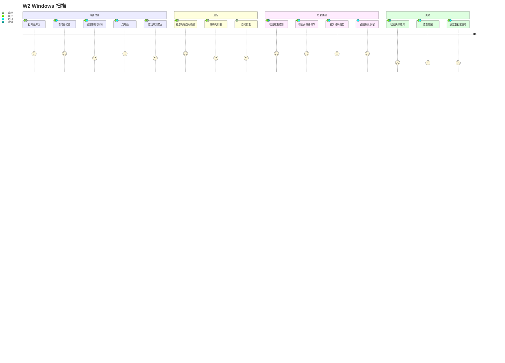

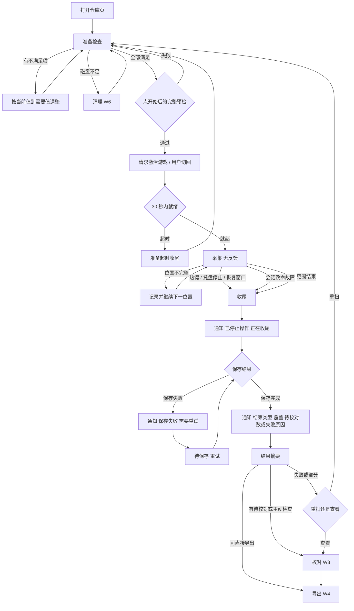

**主路径：** 1 → 13（第 12 步按 P-13，截图默认保留、结束时不询问），正常结束、覆盖完整，直接导出或少量校对后导出。

**边缘路径：**

| 路径 | 说明 | 优先级 |
| --- | --- | --- |
| E1 准备超时 | 30 秒内没切回，或切回后遮挡、独占全屏、纯黑画面、页面不对。到期才知道原因（L-02）。 | P0 |
| E2 激活被拒 | Windows 前台限制，需要用户自己切回（C-05）。 | P0 |
| E3 扫描中失焦 | 通知弹窗、聊天软件、误触 Win 键；扫描停止且不能续扫（C-01、C-06）。 | P0 |
| E4 用户用热键停止 | 正常停止路径；停止后保留结果供查看（F-12）。 | P0 |
| E5 托盘单击 / 双击 | 实为“停止扫描并打开”（C-03、C-13、D-03）。是否改为不停止先实测（P-02）。 | P0 |
| E6 位置不完整但扫描继续 | 结果摘要列出不完整位置及原因（C-08）；将来的只重扫这些位置见 P-12。 | P1 |
| E7 累计 3 个位置不完整 | 升级为整次停止（C-08）。 | P1 |
| E8 保存失败 | 采集停止、收尾停留，提供重试（F-13）。 | P1 |
| E9 有人操作了游戏 | 排序、筛选、布局变化，撤销完整结论并停止（C-02）。 | P1 |
| E10 磁盘空间不足 | 准备检查不通过，直接给出清理入口（C-28 → W6）。 | P1 |
| E11 扫描中关闭 youkai 窗口 | 默认隐藏，扫描继续；但点击 youkai 已让游戏失焦则按失焦停止（F-32）。 | P1 |
| E12 扫描中收到深链接或再次启动 youkai | 等同恢复主窗口 → 停止（C-22、C-23）。 | P2 |
| E13 系统通知不可用 | 退回托盘气泡（P-06）；两者都不可用时，用户只能从游戏画面判断结束。 | P1 |

## W3 校对

**用户目标：** 用最少的操作把待校对的件改对、确认，让它们进入导出；需要时能检查任何一件。

**定位：** P0 能力，但不是每次扫描都要走的步骤。触发条件是：有待校对项，或用户主动想检查；入口来自结果摘要（W2c/W2d）或记录列表（W5a、W5b；导航见 [07 §3.1](07-information-architecture.md#31-推荐方案)、列表见 [08 §5](08-screens.md#5-记录列表历史)）。**实现状态：随 PR-10、PR-12 落地。**

**四类件必须区分**（[05 S7](05-state-matrix.md#s7-校对w3)，定义见 [README 术语](README.md#术语)；判定顺序：先看处理结局，再看 validation，再看 quality，最后看 warning；每件只落入第一个命中的类）：**待补录**（处理结局失败的件，即 OCR 失败，以及中断未处理的件；两者分开展示；补录前不能导出）、**待校对**（`quality=needsReview` 的件，以及历史重开时 `validation.status` 为 `failed` 或 `unavailable` 的件）、**有警告但可导出**（带 warning、满足导出规则，如装备者未识别；用户已决定暂不处理、留空导出）、**已通过**（自动接受或人工确认，且没有 warning）。警告不阻止自动接受，所以有警告的件即使是自动接受也不算“已通过”（[JSON/CSV v2 §3](../../specs/scan-json-format.md#3-一件驱动盘)、[11-02 真机报告](../../reports/2026-11-02-windows-local-field-acceptance.md)第 131 行）。

W3 处理待校对件和待补录件：待补录的件也在校对视图里手动补录（规格允许手动补录使原始失败或未处理记录变为可用，[JSON/CSV v2 §3](../../specs/scan-json-format.md#3-一件驱动盘)），补录后按导出规则转入“已通过”或“有警告但可导出”。警告件不进入校对流程，也不提供批量处理警告的步骤（[06 第 1.2 节](06-proposals-and-phase2.md#12-其他产品决定2026-11-03)）。

| # | 步骤 | 触点 | 用户在想什么 | 情绪 | 痛点风险 |
| --- | --- | --- | --- | --- | --- |
| 1 | 看到全部结果和待校对数（F-16） | 窗口 | “有多少要改？” | 4 | 失败、未处理、字段未知的件必须在列表里（F-16）；警告件不能混进待校对数。 |
| 2 | 跳到第一个待校对项（F-17） | 窗口 | “问题在哪个字段？” | 4 | 问题字段要一眼可见。 |
| 3 | 对照截图看证据（F-18） | 窗口 | “截图上写的是什么？” | 3 | 证据默认折叠会增加步骤（D-07）；证据与表单同时可见、字段能对应证据是保留的功能要求（P-11 第②层）。 |
| 4 | 改字段（F-19） | 窗口、键盘 | “这个值怎么填？” | 3 | 候选值、单位、未知状态（`null`）的表达对普通用户不直观；中文输入法需要可靠。 |
| 5 | 确认并下一项（F-20） | 窗口、键盘 | “下一件。” | 4 | 保存失败要留在当前项；确认后当前项可能离开筛选结果。 |
| 6 | 重复 2–5，直到待校对为空 | 窗口、键盘 | “还剩几件？” | 4 | 连续校对需要全程可用键盘。 |
| 7 | 待校对为空，进入 W4 | 窗口 | “都改好了。” | 5 | — |

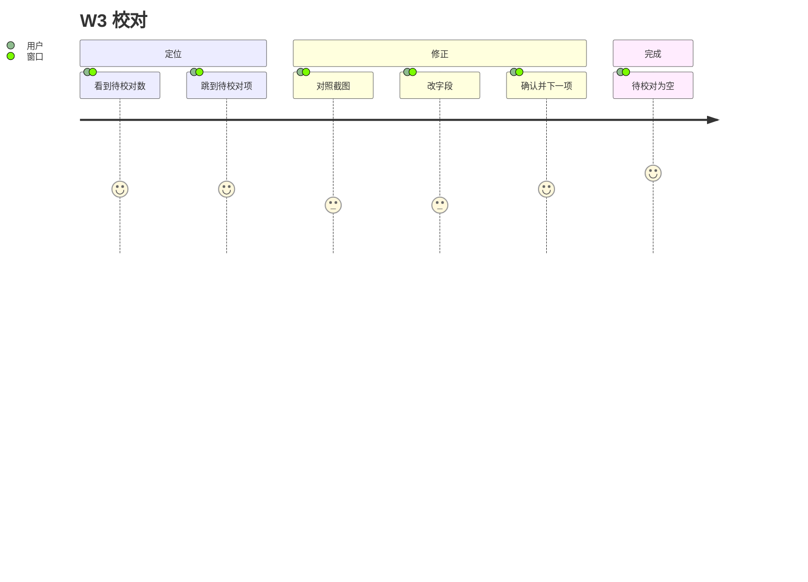

**主路径：** 1 → 7，每件一次修正、一次确认。

**边缘路径：**

| 路径 | 说明 | 优先级 |
| --- | --- | --- |
| E1 校验失败 | 必需字段不完整或校验不通过时不能确认；可以“保存修改”保留未知字段（F-19）。 | P0 |
| E2 保存失败 | 留在当前项、保留输入、可重试（F-20）。 | P1 |
| E3 有未保存修改时切换 | 保存 / 放弃 / 留在当前项（F-21）。 | P0 |
| E4 缺图 | 截图已删除或缺失：显示上下文和缺失说明，不沿用上一件图（F-18）。 | P1 |
| E5 资料不支持的值 | 保留原文与冲突原因，不强行选候选（F-19）。 | P2 |
| E6 重新修改已确认的件 | 需要重新确认（F-20）。 | P2 |
| E7 浏览已通过或有警告的件 | 任何件都可以主动查看和修正（T6 §3 已确认规则）；警告件可以逐件补，但不提供批量流程。 | P1 |

## W4 导出

**用户目标：** 拿到一份通用的 JSON 或 CSV，并清楚它包含什么、不包含什么。只提供通用文件，不针对特定工具适配（[06 第 1.2 节](06-proposals-and-phase2.md#12-其他产品决定2026-11-03)）。

**选择格式的依据**（[JSON/CSV v2 §5](../../specs/scan-json-format.md#5-csv-导出)）：

- **JSON**：带来源会话、覆盖结论、筛选方式、排除数量和只含实际引用条目的目录子集；需要知道“这份数据从哪次扫描来、是否扫全”时选它。
- **CSV**：面向表格的单表，一行一件，副词条展开为列；不含会话外壳、覆盖结论和目录。两者来自同一已保存修订、同一批可用记录，都不含截图（C-27）。

| # | 步骤 | 触点 | 用户在想什么 | 情绪 | 痛点风险 |
| --- | --- | --- | --- | --- | --- |
| 1 | 选择导出 JSON 或 CSV（F-22） | 窗口 | “选哪个格式？” | 4 | 两个并列入口、无默认格式；格式区别要在选择时可见（见上）。 |
| 2 | 看到纳入数、排除数、覆盖结论、“不含截图” | 窗口 | “为什么少了几件？” | 3 | 排除原因要能追到“去校对”（→ W3）；警告件已纳入，不算排除。部分扫描的导出要讲清不是完整库存（C-27）。 |
| 3 | 文件写入下载目录 | 窗口 | “写到哪里了？” | 4 | 不打开保存对话框；同名自动编号；目录不可写或空间不足时如实失败。 |
| 4 | 打开下载目录找到文件（F-23） | 窗口、系统 | “找到了。” | 5 | 当前实现成功后没有“打开目录”入口（D-11）。 |

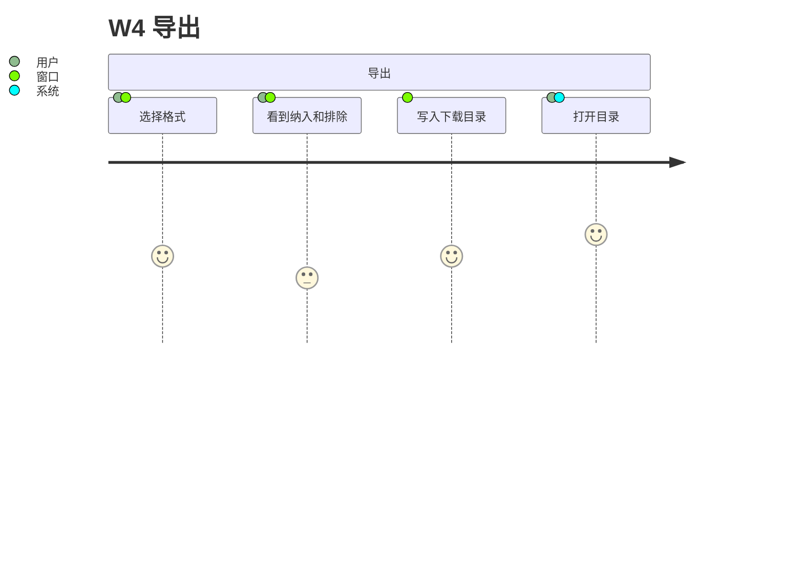

**边缘路径：** 有未保存修改需先解决（P0）；可用数为零时说明原因、默认引导去处理排除原因，规格仍允许导出空文件（P1）；导出失败不影响内部记录（P1）；导出中该记录不可删除（P2）。

## W5b 历史列表与筛选

**用户目标：** 找回较早的某次扫描，继续校对或再次导出。打开最近一条记录属于主干，见 W5a。

| # | 步骤 | 触点 | 用户在想什么 | 情绪 | 痛点风险 |
| --- | --- | --- | --- | --- | --- |
| 1 | 打开历史记录列表（F-24） | 窗口 | “那次扫描在哪？” | 4 | 列表要能区分日期、客户端、件数、覆盖与校对状态（D-08）。 |
| 2 | 按日期筛选 | 窗口 | “是哪天的？” | 3 | 手输日期格式不友好（D-08）。 |
| 3 | 打开一条记录（F-25） | 窗口 | “数据还在吗？” | 4 | 重开会按当前资料重校验，可能出现新的冲突项。 |
| 4 | 继续校对（W3）或导出（W4） | 窗口 | — | 4 | 重开不续扫；中断记录只能查看和校对（F-25）。 |

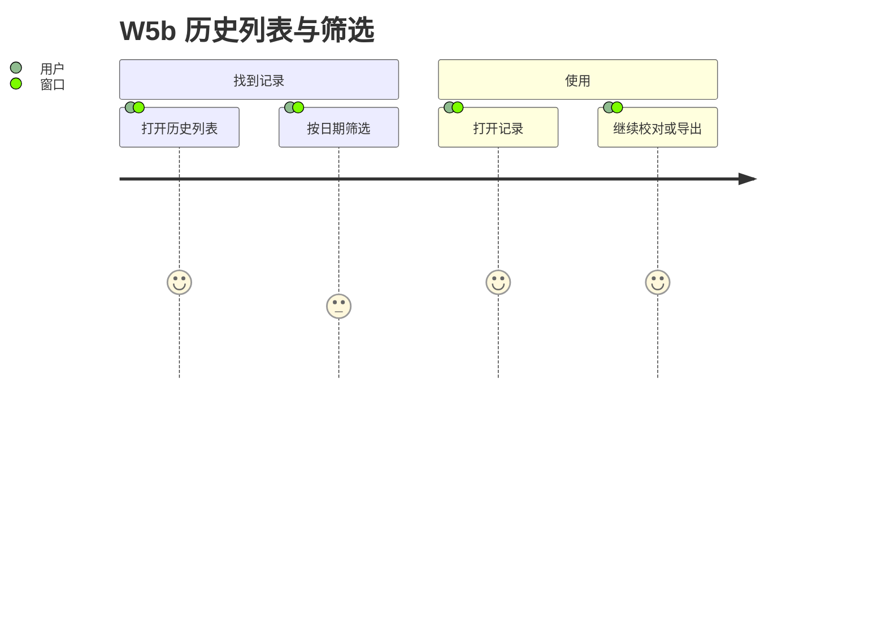

**边缘路径：** 重校验后出现冲突，旧确认不能绕过（P1）；记录损坏、版本不支持或无有效检查点（P1）；带删除标记、待完成清理的记录（P2）。扫描中打开主窗口即停止扫描（C-03），所以不存在“扫描中浏览历史”。历史列表只做记录级的并排比较，不做件级跨扫描对比（[06 第 1.2 节](06-proposals-and-phase2.md#12-其他产品决定2026-11-03)）。

## W6 清理

**用户目标：** 释放磁盘空间，或删除不再需要的记录，不误删正在用的数据。

**定位：** P2 能力，但磁盘不足阻止开始扫描时，它是准备检查里直接可达的出口（C-28）。

| # | 步骤 | 触点 | 用户在想什么 | 情绪 | 痛点风险 |
| --- | --- | --- | --- | --- | --- |
| 1 | 从准备检查（磁盘不足）、校对后、导出后、历史或存储管理进入（F-15、P-13） | 窗口 | “截图占多少空间？” | 3 | 扫描结束时不询问截图去留（P-13），删除入口放在校对后、导出后和清理页。 |
| 2 | 选择清理范围：单条记录的截图或记录（F-26），全部截图或全部记录、缓存、旧日志（F-27） | 窗口 | “删了会怎样？” | 3 | “删除截图”与“删除记录”的差别必须清楚；清缓存不能代替删除。 |
| 3 | 看到影响预览（记录数、估计容量、待校对数）并确认 | 窗口 | “确定吗？” | 3 | 不因曾经导出而跳过确认（C-28）。 |
| 4 | 清理完成，占用刷新；从准备检查进入的回到准备检查 | 窗口 | “空间回来了。” | 4 | 部分失败时保留失败项和重试入口。 |

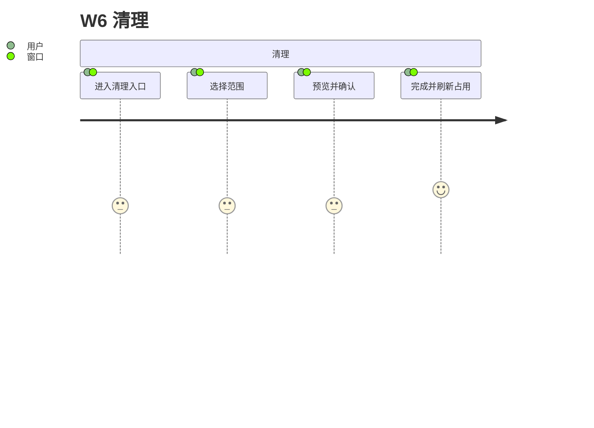

**边缘路径：** 记录被活动扫描、收尾保存、导出或未保存编辑占用，显示原因（P1）；部分失败与重试（P1）；打开数据目录手动查看（P2）。

## W7 设置与更新

**用户目标：** 让 youkai 按自己的习惯运行，并保持最新版本。

| # | 步骤 | 触点 | 用户在想什么 | 情绪 | 痛点风险 |
| --- | --- | --- | --- | --- | --- |
| 1 | 设置关窗行为（F-28） | 窗口 | “点 × 是退出还是隐藏？” | 4 | 默认隐藏，需要与 W8 的“怎样真正退出”配合理解（C-20）。 |
| 2 | 查看快捷键（F-29） | 窗口 | “停止键是什么？” | 4 | 必须显示 Windows 的按键写法（D-02）。 |
| 3 | 收到新版本（启动、每 24 小时或手动检查，F-30） | 窗口 | “要更新吗？更新说明是什么？” | 4 | 检查不激活窗口，用户可能很久才看到。 |
| 4 | 安装更新 | 窗口 | “会丢数据吗？” | 3 | 扫描、收尾、待重试保存期间禁止安装并说明原因（C-24）。 |
| 5 | 自动退出收尾并重启进入新版本 | 窗口 | “好了。” | 4 | 保存失败会拒绝退出，更新推迟到下次启动；以管理员身份运行时的更新行为未实测（C-10）。 |

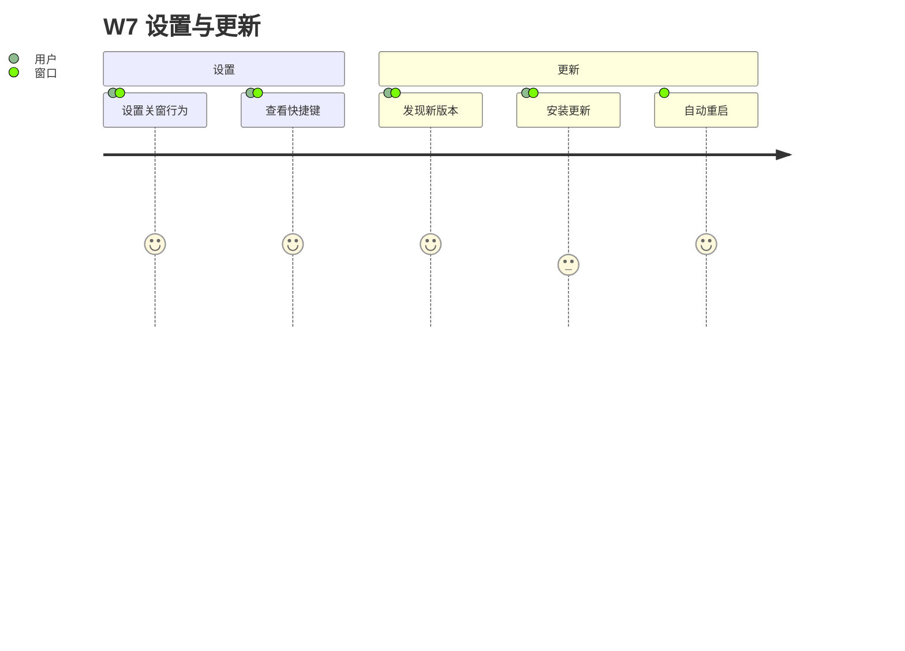

**边缘路径：** 扫描中发现更新（安装被阻止，P1）；签名错误导致安装失败、继续运行原版本（P2）；检查失败（P2，可复制诊断信息，P-15）；开发运行或测试打包不支持更新（P2）；保存设置失败（P2）。

## W8 托盘与退出

**用户目标：** 关窗后应用安静地待在后台；需要时能找回来；想退出时干净地退出、不丢数据。

| # | 步骤 | 触点 | 用户在想什么 | 情绪 | 痛点风险 |
| --- | --- | --- | --- | --- | --- |
| 1 | 点 × 关闭窗口（F-32） | 窗口 | “关掉了吗？” | 3 | 默认只是隐藏（C-20）；用户可能以为已退出。 |
| 2 | 首次隐藏时看到图标位置提示（P-10 已决定），找到托盘图标（F-33） | 托盘 | “图标在哪？” | 3 | Windows 11 默认放在溢出区（C-13）；提示要能之后重看。 |
| 3 | 左键单击恢复主窗口（F-34） | 托盘、窗口 | “回来了。” | 4 | 扫描中单击即停止扫描（C-03、D-03；P-02 先实测）。 |
| 4 | 右键菜单选“退出”（F-35） | 托盘 | “真的退出了吗？” | 4 | 退出需要收尾保存，可能不是瞬间完成（C-21）。 |
| 5 | 退出完成 | — | — | 4 | — |

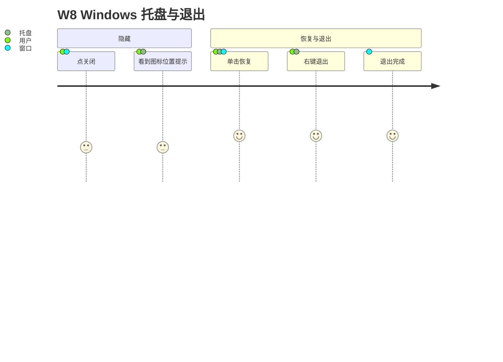

**边缘路径：**

| 路径 | 说明 | 优先级 |
| --- | --- | --- |
| E1 扫描中单击托盘 | 停止扫描并打开（C-03、D-03）；P-02 先实测。 | P0 |
| E2 退出时保存失败 | 进程保持、窗口恢复、显示重试；不谎报退出完成（C-21）。 | P1 |
| E3 退出时有未保存编辑 | 先提示保存 / 放弃 / 留在当前项，窗口被恢复（F-21、F-35）。 | P1 |
| E4 托盘不可用 | 关窗改为停止并退出，窗口说明原因（C-20）。 | P1 |
| E5 设置为“关闭即退出” | 点 × 走明确退出收尾（F-28）。 | P2 |
| E6 再次双击桌面图标 | 交给已运行实例并恢复窗口（C-22）；提权时的“先退出旧实例”见 W1 步骤 4。 | P1 |
| E7 从网页唤起 | 只打开主窗口（C-23）。 | P2 |
