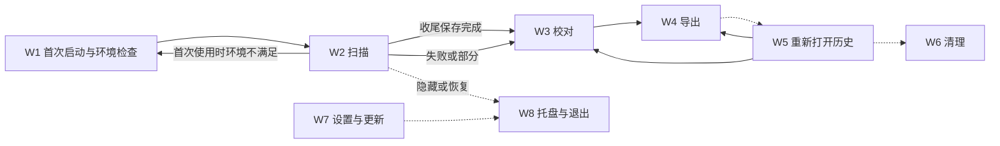
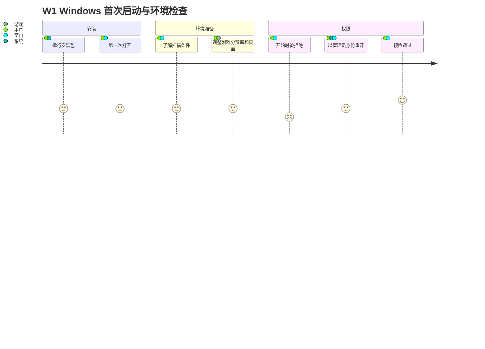
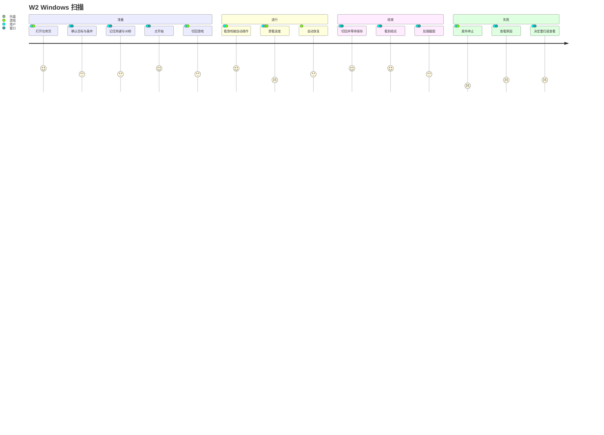
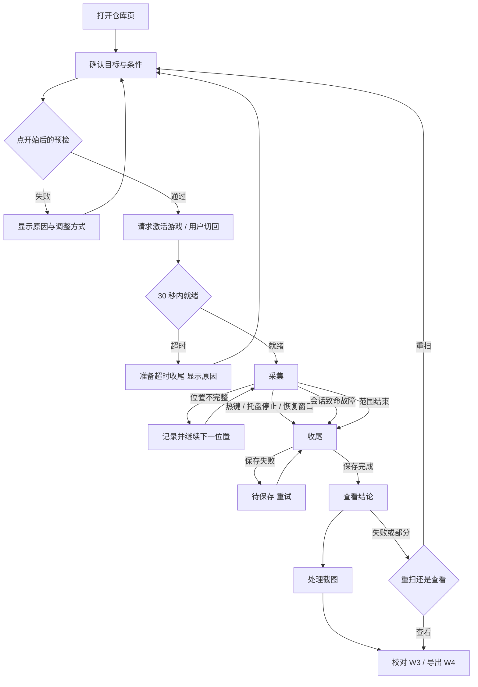
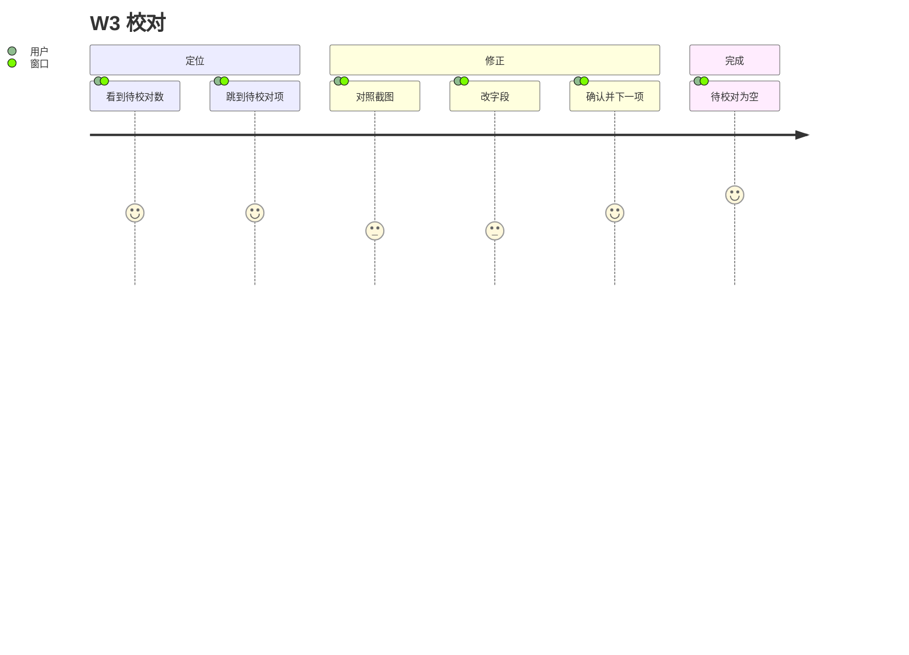
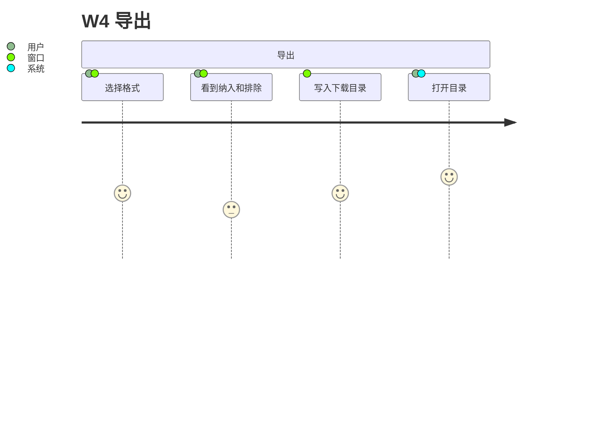
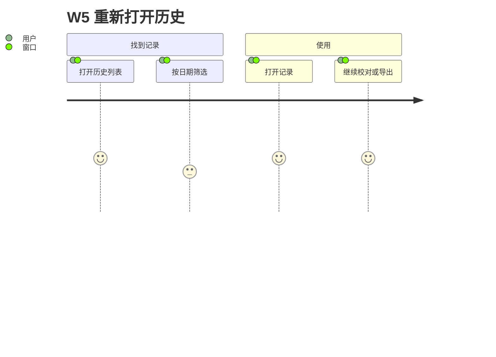
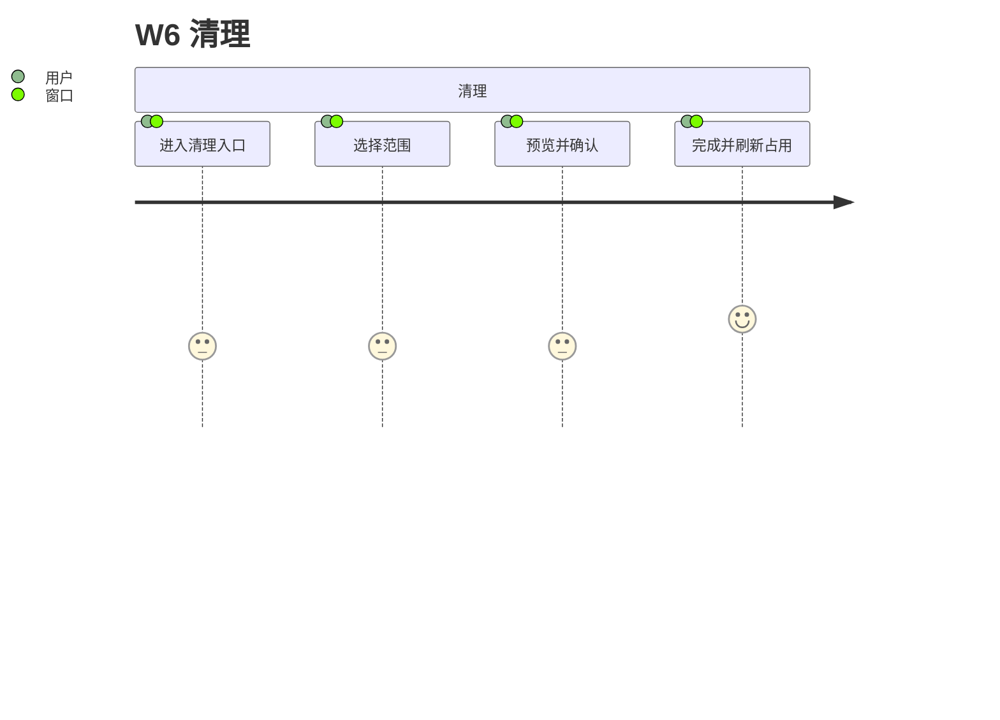
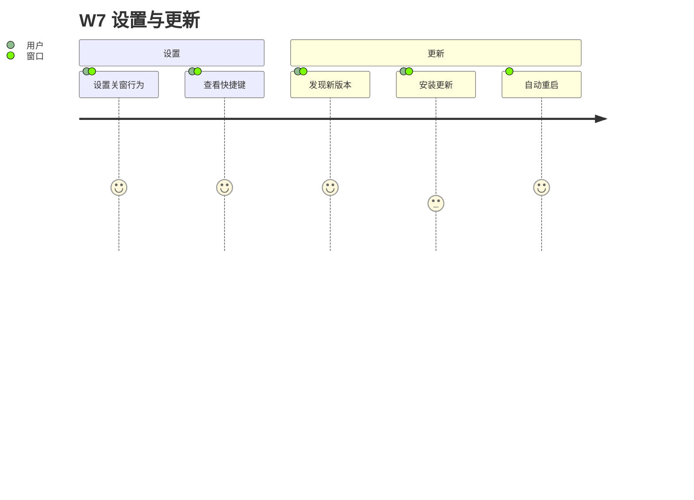
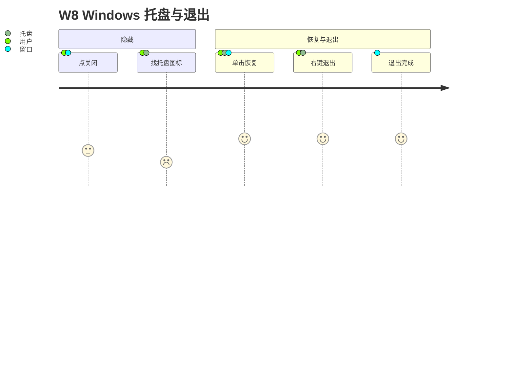

# 03 用户旅程：Windows 本地客户端用户

第一阶段草案（2026-11-03）。画像见 [README](README.md#用户画像与范围)。功能编号 `F-xx` 见 [01](01-functions.md)，约束编号 `C-xx` 见 [02](02-constraints.md)，各步骤的状态细节见 [05](05-state-matrix.md)。

## 写法说明

- **触点**：窗口（youkai 主窗口）、托盘（通知区域图标及其菜单）、热键（全局停止热键）、游戏（《绝区零》客户端窗口）、系统（安装器、UAC、资源管理器等系统界面）。
- **情绪**：1（沮丧）到 5（顺畅）。Mermaid `journey` 图中的分数即此值，是设计判断，不是测量结果。
- **优先级**：P0 = 首版必须顺畅，否则主流程走不通；P1 = 高频或高风险，应在首版处理好；P2 = 低频，可以简单处理。
- 旅程只描述“做什么、在哪里、感觉如何”，不描述布局。

## 旅程一览

| 编号 | 旅程 | 优先级 | 对应功能 |
| --- | --- | --- | --- |
| W1 | 首次启动与环境检查（含管理员权限） | P0 | F-01–F-05、F-07、F-08 |
| W2 | 扫描：准备 → 进行 → 结束 / 失败 | P0 | F-06–F-15 |
| W3 | 校对 | P0 | F-16–F-21 |
| W4 | 导出 | P0 | F-22、F-23 |
| W5 | 重新打开历史 | P1 | F-24、F-25 |
| W6 | 清理 | P2 | F-15、F-26、F-27 |
| W7 | 设置与更新 | P2（更新受阻时 P1） | F-28–F-31 |
| W8 | 托盘与退出 | P1 | F-32–F-35 |

准备失败或扫描失败后，一般回到 W2a 修正条件再开始（见 W2 流程图）；只有首次使用、环境整体还没准备好时才回到 W1。

## W1 首次启动与环境检查

**用户目标：** 装好 youkai，确认“我的电脑和游戏能用它扫描”，在第一次扫描前把需要调整的地方一次调好。

**触发：** 下载安装包后第一次打开；或换了电脑、改了游戏设置后第一次扫描。

| # | 步骤 | 触点 | 用户在想什么 | 情绪 | 痛点风险 |
| --- | --- | --- | --- | --- | --- |
| 1 | 运行安装包（F-01） | 系统 | “这个安装包安全吗？” | 3 | 未签名，SmartScreen 可能拦截（C-14）；用户不知道是否该继续。 |
| 2 | 第一次打开 youkai | 窗口 | “接下来要做什么？” | 3 | 首屏如果直接是空白的“开始扫描”，用户不知道需要先准备游戏。 |
| 3 | 了解扫描前要满足的条件（F-07） | 窗口 | “游戏要怎么设置？” | 3 | 条件分散：仓库页（C-07）、1920×1080 窗口（C-11）、工作区（C-12）、管理员权限（C-10）、停止热键（C-04）。只在失败后才告诉用户会造成反复试错。 |
| 4 | 调整游戏：1920×1080 窗口或无边框模式，放在屏幕内，打开驱动盘仓库页（F-06） | 游戏 | “调好了吗？” | 3 | youkai 能否在开始前就告诉用户“当前是 2560×1440，请切到 1920×1080”？依赖预检能否在不开始扫描的情况下运行（见 06 P-03）。 |
| 5 | 第一次点开始，遇到权限拒绝（F-08） | 窗口 | “为什么要管理员？安全吗？” | 2 | 游戏以管理员运行时必然被拒（C-10）；用户要退出 youkai、右键以管理员身份重新打开。这一步会丢失“已经点了开始”的心理进度。 |
| 6 | 以管理员身份重新打开 youkai | 系统、窗口 | “这次应该可以了。” | 3 | UAC 弹窗；提权后的单实例、深链接、自动更新未实测（C-10）。若此前普通权限实例仍在托盘里运行，按单实例规则第二次启动会交给它（C-22），提权就没有生效（提权后的单实例行为未实测）。 |
| 7 | 预检通过，进入 W2 | 窗口 | “终于可以开始了。” | 4 | — |

**主路径：** 1 → 2 → 3 → 4 → 7（youkai 已以管理员身份运行，或游戏未提权）。

**边缘路径：**

| 路径 | 说明 | 优先级 |
| --- | --- | --- |
| E1 权限不足 | 步骤 5–6。最常见的首次失败，提示必须包含“为什么需要”和“怎么做”，以及只发送鼠标输入的说明（C-10）。 | P0 |
| E2 权限查询失败 | `integrityUnverifiable`，按拒绝处理，同样提示以管理员身份运行。 | P1 |
| E3 分辨率不受支持 | 已知未开放档位与未知尺寸分别提示，都要写出“请切到 1920×1080 窗口或无边框模式”（C-11）。 | P0 |
| E4 窗口超出工作区或独占全屏 | 4K 屏上窗口被任务栏裁掉、跨屏、独占全屏（C-12）。 | P0 |
| E5 停止热键被占用 | 热键注册失败不能开始（C-04）；规格要求可自定义（[T2 §2.2](../../specs/t2-platform-capture-input.md#22-macosscreencapturekit-窗口流与-quartz-输入) 第 85 行），实现排在 M3，当前不能改键（D-10）。 | P1 |
| E6 普通权限实例仍在托盘 | 关窗只是隐藏（C-20），以管理员身份再次启动按单实例规则会被转交给旧实例，提权没有生效，用户却不知道原因（提权后的单实例行为未实测）。是否提供提权重启见 P-05。 | P1 |
| E7 SmartScreen / Smart App Control 拦截 | 系统层面，youkai 无法在应用内处理，只能在下载页或说明中告知（C-14）。 | P2 |
| E8 资源缺失或损坏 | 安装不完整时识别资源报错（F-05）。 | P2 |
| E9 DPI 检查不通过 | 切回游戏前的 Setup 类检查（F-08），故障码 `dpiAwarenessMismatch`、`dpiVirtualized`、`dpiCheckUnavailable`；当前没有中文提示（D-04）。目前只有 125% 缩放有实测证据，100% 等其他缩放未验证（[T2 §3.2](../../specs/t2-platform-capture-input.md#32-可验收的窄显示配置候选)），其他缩放下是否会触发未验证（推断）。 | P1 |

## W2 扫描

**用户目标：** 把驱动盘仓库完整、可信地扫一遍，过程中不用盯着，结束后知道结果是否可信。

**触发：** 首次使用，或游戏里驱动盘变化后想更新数据。

### W2a 准备

| # | 步骤 | 触点 | 用户在想什么 | 情绪 | 痛点风险 |
| --- | --- | --- | --- | --- | --- |
| 1 | 在游戏中打开驱动盘仓库页（F-06） | 游戏 | “要先设置筛选吗？” | 4 | 用户可能以为要手动设置筛选或排序；实际扫描器会自己做，但不碰排序（C-07）。 |
| 2 | 切到 youkai，确认目标与条件（F-07） | 窗口 | “它找到我的游戏了吗？” | 3 | 当前安装版没有扫描源、也没有客户端选择（D-01）；多候选窗口时需要用户选目标。 |
| 3 | 记住停止热键和 30 秒规则 | 窗口 | “中途想停怎么办？” | 3 | 当前界面没有显示 30 秒和实际热键（D-02）；用户点开始后才知道要赶时间。 |
| 4 | 点开始（F-09），可选择隐藏（F-10） | 窗口 | “开始了。” | 4 | 不依赖前台的预检失败会立刻返回原因（F-08）。 |
| 5 | 切回游戏（应用请求激活一次） | 游戏 | “要我自己切吗？” | 3 | 激活可能被系统拒绝，用户需要自己 Alt+Tab（C-05）；30 秒内遮挡、独占全屏、纯黑画面检查才开始，失败原因要到期后才显示（L-02）。 |

### W2b 进行

| # | 步骤 | 触点 | 用户在想什么 | 情绪 | 痛点风险 |
| --- | --- | --- | --- | --- | --- |
| 6 | 看着游戏被自动操作（转盘、筛选、回顶、逐件点选） | 游戏 | “它在正常工作吗？” | 4 | 用户只能从游戏画面判断进度；扫描中看不到 youkai（C-01、C-03）。 |
| 7 | 想看进度 | 托盘（悬停提示）、游戏 | “还要多久？” | 2 | 总数未知，不显示百分比（C-09）；打开主窗口会停止扫描（C-03）。托盘悬停提示**推断**不会停止扫描，但**待实测**：用户要在扫描中移动物理鼠标，与 C-02“不能手动操作游戏”冲突，对扫描器自身鼠标输入落点的影响未测（Windows 只验证了空闲态托盘，扫描中的托盘行为未测，见 [Windows 托盘诊断报告](../../reports/2026-11-03-windows-tray-diagnosis.md)第 17、21 行；macOS 扫描中的托盘行为同样未验，见 [M3 验收清单](../../reports/2026-10-20-m3-acceptance-checklist.md)第 228 行）。信息量也有限。 |
| 8 | 自动恢复（某位置未完成，继续下一位置） | 游戏 | “刚才是不是出错了？” | 3 | 恢复不打断扫描（C-08），用户可能在结束时才知道有位置不完整。 |

### W2c 结束（正常）

| # | 步骤 | 触点 | 用户在想什么 | 情绪 | 痛点风险 |
| --- | --- | --- | --- | --- | --- |
| 9 | 扫描到范围末尾，游戏停止被操作 | 游戏 | “结束了吗？” | 3 | 完成提示不能激活窗口（C-09），用户要自己切回 youkai。 |
| 10 | 切回 youkai，等待收尾保存（F-13） | 窗口、托盘 | “数据保存了吗？” | 4 | 收尾可能需要一段时间结束识别；保存失败需要重试。 |
| 11 | 看到结论：覆盖、待校对数、保存状态（F-14） | 窗口 | “扫全了吗？要改几件？” | 4 | 只看到“完成”会误导（C-26）。 |
| 12 | 处理截图（保留 / 删除 / 稍后，F-15） | 窗口 | “截图要不要留？” | 3 | 截图处理提示与校对入口同时出现，用户可能不理解删除截图会影响校对（缺图）。 |
| 13 | 进入 W3 校对，或直接 W4 导出 | 窗口 | — | 4 | — |

### W2d 失败或用户停止

| # | 步骤 | 触点 | 用户在想什么 | 情绪 | 痛点风险 |
| --- | --- | --- | --- | --- | --- |
| 14 | 扫描意外停止（失焦、遮挡、页面失效、几何变化、3 个位置不完整等） | 游戏 | “怎么停了？” | 1 | 在游戏里只能看到“不再被操作”；原因在 youkai 里。 |
| 15 | 切回 youkai，看到原因和已保存的部分（F-14） | 窗口 | “是我的问题还是它的问题？能怎么办？” | 2 | 原因只给故障码或英文时，用户无法行动（D-04、C-29）。 |
| 16 | 决定：查看已采集部分（→ W3）或修正后重新开始（→ W2a） | 窗口 | “要从头再来吗？” | 2 | 没有续扫（C-06）；千件扫描中途失败代价很高。 |

**主路径：** 1 → 13，正常结束且覆盖完整。

**边缘路径：**

| 路径 | 说明 | 优先级 |
| --- | --- | --- |
| E1 准备超时 | 30 秒内没切回，或切回后遮挡、独占全屏、纯黑画面、页面不对。到期才知道原因（L-02）。 | P0 |
| E2 激活被拒 | Windows 前台限制，需要用户自己切回（C-05）。 | P0 |
| E3 扫描中失焦 | 通知弹窗、聊天软件、误触 Win 键；扫描停止且不能续扫（C-01、C-06）。 | P0 |
| E4 用户用热键停止 | 正常停止路径；停止后保留结果供查看（F-12）。 | P0 |
| E5 托盘单击 / 双击查看进度 | 实为“停止扫描并打开”（C-03、C-13、D-03）。用户的意图是看进度，结果停止了扫描。 | P0 |
| E6 位置不完整但扫描继续 | 结束时列出不完整位置及原因（C-08）。 | P1 |
| E7 累计 3 个位置不完整 | 升级为整次停止（C-08）。 | P1 |
| E8 保存失败 | 采集停止、收尾停留，提供重试；截图提示不出现（F-13）。 | P1 |
| E9 有人操作了游戏 | 排序、筛选、布局变化，撤销完整结论并停止（C-02）。 | P1 |
| E10 磁盘空间不足 | 开始前阻止，提示去清理（C-28 → W6）。 | P1 |
| E11 扫描中关闭 youkai 窗口 | 默认隐藏，扫描继续；但点击 youkai 已让游戏失焦则按失焦停止（F-32）。 | P1 |
| E12 扫描中收到深链接或再次启动 youkai | 等同恢复主窗口 → 停止（C-22、C-23）。 | P2 |

## W3 校对

**用户目标：** 用最少的操作把待校对的件改对、确认，让它们进入导出；需要时能检查任何一件。

**触发：** 扫描结束后（W2c/W2d），或重新打开历史（W5）。

| # | 步骤 | 触点 | 用户在想什么 | 情绪 | 痛点风险 |
| --- | --- | --- | --- | --- | --- |
| 1 | 看到全部结果和待校对数（F-16） | 窗口 | “有多少要改？” | 4 | 失败、未处理、字段未知的件必须在列表里（F-16）。 |
| 2 | 跳到第一个待校对项（F-17） | 窗口 | “问题在哪个字段？” | 4 | 问题字段要一眼可见。 |
| 3 | 对照截图看证据（F-18） | 窗口 | “截图上写的是什么？” | 3 | 证据默认折叠会增加步骤（D-07）；裁剪图需要能放大、能对应到字段。 |
| 4 | 改字段（F-19） | 窗口、键盘 | “这个值怎么填？” | 3 | 候选值、单位、未知状态（`null`）的表达对普通用户不直观；中文输入法需要可靠。 |
| 5 | 确认并下一项（F-20） | 窗口、键盘 | “下一件。” | 4 | 保存失败要留在当前项；确认后当前项可能离开筛选结果。 |
| 6 | 重复 2–5，直到待校对为空 | 窗口、键盘 | “还剩几件？” | 4 | 连续校对需要全程可用键盘。 |
| 7 | 待校对为空，进入 W4 | 窗口 | “都改好了。” | 5 | — |

**主路径：** 1 → 7，每件一次修正、一次确认。

**边缘路径：**

| 路径 | 说明 | 优先级 |
| --- | --- | --- |
| E1 校验失败 | 必需字段不完整或校验不通过时不能确认；可以“保存修改”保留未知字段（F-19）。 | P0 |
| E2 保存失败 | 留在当前项、保留输入、可重试（F-20）。 | P1 |
| E3 有未保存修改时切换 | 保存 / 放弃 / 留在当前项（F-21）。 | P0 |
| E4 缺图 | 截图已删除或缺失：显示上下文和缺失说明，不沿用上一件图（F-18）。 | P1 |
| E5 资料不支持的值 | 保留原文与冲突原因，不强行选候选（F-19）。 | P2 |
| E6 重新修改已确认的件 | 需要重新确认（F-20）。 | P2 |
| E7 不校对、直接导出 | 自动接受的件可直接导出，待校对件不纳入（C-27）。 | P0 |
| E8 浏览已通过的件 | 任何件都可以主动查看和修正（T6 §3 已确认规则）。 | P1 |

## W4 导出

**用户目标：** 拿到一份可交给其他工具的 JSON 或 CSV，并清楚它包含什么、不包含什么。

| # | 步骤 | 触点 | 用户在想什么 | 情绪 | 痛点风险 |
| --- | --- | --- | --- | --- | --- |
| 1 | 选择导出 JSON 或 CSV（F-22） | 窗口 | “选哪个格式？” | 4 | 两个并列入口、无默认格式；用户可能不清楚差别。 |
| 2 | 看到纳入数、排除数、覆盖结论、“不含截图” | 窗口 | “为什么少了几件？” | 3 | 排除原因要能追到“去校对”（→ W3）。部分扫描的导出要讲清不是完整库存（C-27）。 |
| 3 | 文件写入下载目录 | 窗口 | “写到哪里了？” | 4 | 不打开保存对话框；同名自动编号；目录不可写或空间不足时如实失败。 |
| 4 | 打开下载目录找到文件（F-23） | 窗口、系统 | “找到了。” | 5 | — |

**边缘路径：** 有未保存修改需先解决（P0）；可用数为零时说明原因、仍可导出空文件（P1）；导出失败不影响内部记录（P1）；导出中该记录不可删除（P2）。

## W5 重新打开历史

**用户目标：** 找回某次扫描，继续校对或再次导出。

| # | 步骤 | 触点 | 用户在想什么 | 情绪 | 痛点风险 |
| --- | --- | --- | --- | --- | --- |
| 1 | 打开应用后找到历史记录列表（F-24） | 窗口 | “我上次扫的在哪？” | 4 | 列表要能区分日期、客户端、件数、覆盖与校对状态（D-08）。 |
| 2 | 按日期筛选 | 窗口 | “是哪天的？” | 3 | 手输日期格式不友好（D-08）。 |
| 3 | 打开一条记录（F-25） | 窗口 | “数据还在吗？” | 4 | 重开会按当前资料重校验，可能出现新的冲突项。 |
| 4 | 继续校对（W3）或导出（W4） | 窗口 | — | 4 | 重开不续扫；中断记录只能查看和校对（F-25）。 |

**边缘路径：** 重校验后出现冲突，旧确认不能绕过（P1）；记录损坏、版本不支持或无有效检查点（P1）；带删除标记、待完成清理的记录（P2）；扫描进行中查看历史——需要先确认扫描中能否打开主窗口（C-03，扫描中打开主窗口即停止，因此“扫描中浏览历史”实际不存在，P2）。

## W6 清理

**用户目标：** 释放磁盘空间，或删除不再需要的记录，不误删正在用的数据。

| # | 步骤 | 触点 | 用户在想什么 | 情绪 | 痛点风险 |
| --- | --- | --- | --- | --- | --- |
| 1 | 扫描后处理截图（F-15），或之后从历史 / 存储管理进入 | 窗口 | “截图占多少空间？” | 3 | — |
| 2 | 选择清理范围：单条记录的截图或记录（F-26），全部截图或全部记录、缓存、旧日志（F-27） | 窗口 | “删了会怎样？” | 3 | “删除截图”与“删除记录”的差别必须清楚；清缓存不能代替删除。 |
| 3 | 看到影响预览（记录数、估计容量、待校对数）并确认 | 窗口 | “确定吗？” | 3 | 不因曾经导出而跳过确认（C-28）。 |
| 4 | 清理完成，占用刷新 | 窗口 | “空间回来了。” | 4 | 部分失败时保留失败项和重试入口。 |

**边缘路径：** 记录被活动扫描、收尾保存、导出或未保存编辑占用，显示原因（P1）；部分失败与重试（P1）；空间不足阻止开始扫描时从 W2 跳入（P1）；打开数据目录手动查看（P2）。

## W7 设置与更新

**用户目标：** 让 youkai 按自己的习惯运行，并保持最新版本。

| # | 步骤 | 触点 | 用户在想什么 | 情绪 | 痛点风险 |
| --- | --- | --- | --- | --- | --- |
| 1 | 设置关窗行为（F-28） | 窗口 | “点 × 是退出还是隐藏？” | 4 | 默认隐藏，需要与 W8 的“怎样真正退出”配合理解（C-20）。 |
| 2 | 查看快捷键（F-29） | 窗口 | “停止键是什么？” | 4 | 必须显示 Windows 的按键写法（D-02）。 |
| 3 | 收到新版本（启动、每 24 小时或手动检查，F-30） | 窗口 | “要更新吗？更新说明是什么？” | 4 | 检查不激活窗口，用户可能很久才看到。 |
| 4 | 安装更新 | 窗口 | “会丢数据吗？” | 3 | 扫描、收尾、待重试保存期间禁止安装并说明原因（C-24）。 |
| 5 | 自动退出收尾并重启进入新版本 | 窗口 | “好了。” | 4 | 保存失败会拒绝退出，更新推迟到下次启动；以管理员身份运行时的更新行为未实测（C-10）。 |

**边缘路径：** 扫描中发现更新（安装被阻止，P1）；签名错误导致安装失败、继续运行原版本（P2）；检查失败（P2）；开发运行或测试打包不支持更新（P2）；保存设置失败（P2）。

## W8 托盘与退出

**用户目标：** 关窗后应用安静地待在后台；需要时能找回来；想退出时干净地退出、不丢数据。

| # | 步骤 | 触点 | 用户在想什么 | 情绪 | 痛点风险 |
| --- | --- | --- | --- | --- | --- |
| 1 | 点 × 关闭窗口（F-32） | 窗口 | “关掉了吗？” | 3 | 默认只是隐藏（C-20）；用户可能以为已退出。 |
| 2 | 找到托盘图标（F-33） | 托盘 | “图标在哪？” | 2 | Windows 11 默认放在溢出区（C-13）。 |
| 3 | 左键单击恢复主窗口（F-34） | 托盘、窗口 | “回来了。” | 4 | 扫描中单击即停止扫描（C-03、D-03）。 |
| 4 | 右键菜单选“退出”（F-35） | 托盘 | “真的退出了吗？” | 4 | 退出需要收尾保存，可能不是瞬间完成（C-21）。 |
| 5 | 退出完成 | — | — | 4 | — |

**边缘路径：**

| 路径 | 说明 | 优先级 |
| --- | --- | --- |
| E1 扫描中单击托盘 | 停止扫描并打开（C-03、D-03）。 | P0 |
| E2 退出时保存失败 | 进程保持、窗口恢复、显示重试；不谎报退出完成（C-21）。 | P1 |
| E3 退出时有未保存编辑 | 先提示保存 / 放弃 / 留在当前项，窗口被恢复（F-21、F-35）。 | P1 |
| E4 托盘不可用 | 关窗改为停止并退出，窗口说明原因（C-20）。 | P1 |
| E5 设置为“关闭即退出” | 点 × 走明确退出收尾（F-28）。 | P2 |
| E6 再次双击桌面图标 | 交给已运行实例并恢复窗口（C-22）；以管理员身份启动时见 W1 E6。 | P1 |
| E7 从网页唤起 | 只打开主窗口（C-23）。 | P2 |
