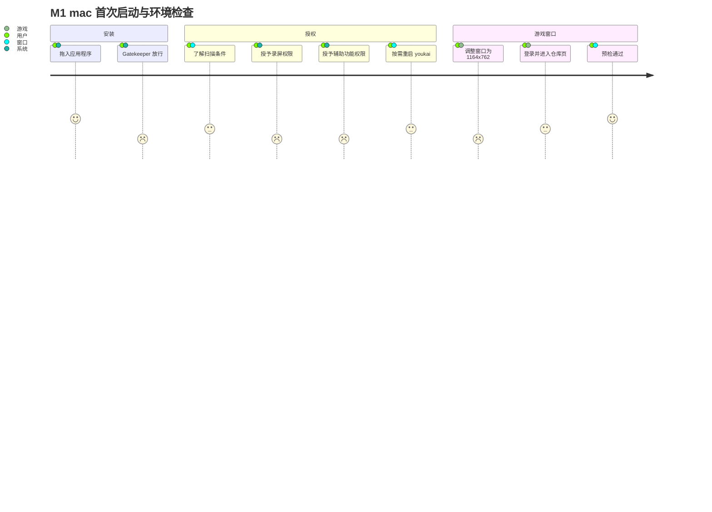
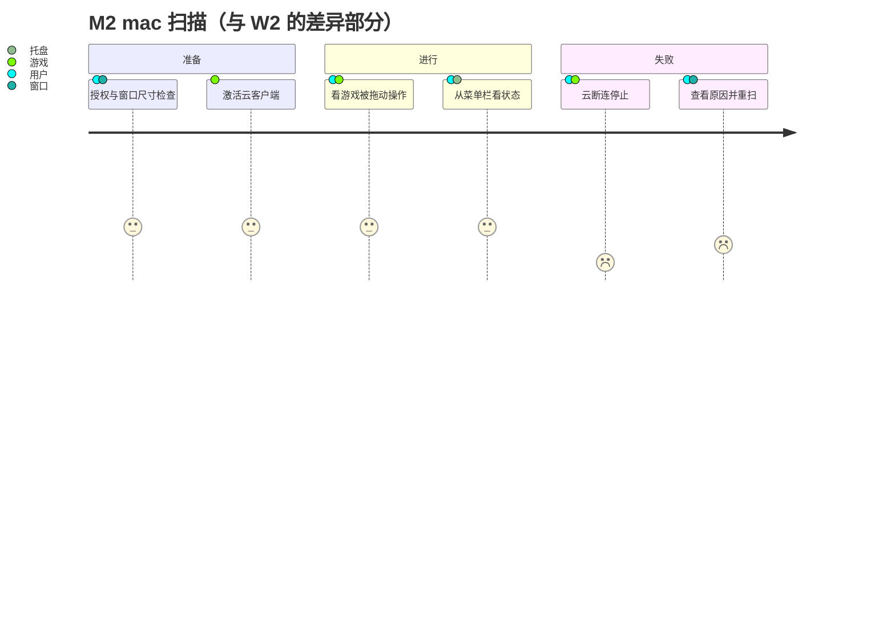
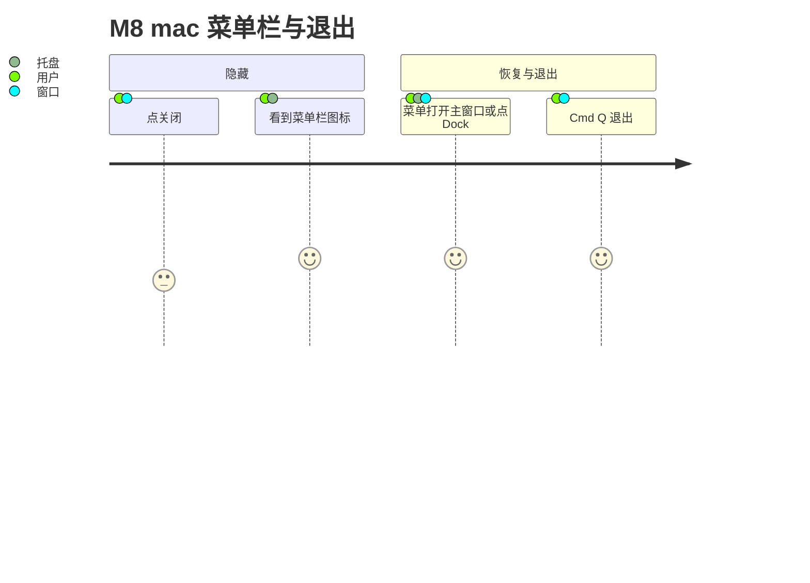

# 04 用户旅程：mac 云客户端用户

第一阶段草案（2026-11-03）。画像见 [README](README.md#用户画像与范围)。写法（触点、情绪分、优先级）同 [03](03-journeys-windows.md#写法说明)；mac 的触点“托盘”指菜单栏图标，另有 Dock。

与 Windows 相同的旅程只引用 03 并列出差异，避免两份正文分叉。

## 旅程一览

| 编号 | 旅程 | 与 Windows 的关系 | 优先级 |
| --- | --- | --- | --- |
| M1 | 首次启动与环境检查（含系统授权） | 完整重写：安装、授权、窗口尺寸都不同 | P0 |
| M2 | 扫描：准备 → 进行 → 结束 / 失败 | 结构同 [W2](03-journeys-windows.md#w2-扫描)，差异见下 | P0 |
| M3 | 校对 | 同 [W3](03-journeys-windows.md#w3-校对) | P0 |
| M4 | 导出 | 同 [W4](03-journeys-windows.md#w4-导出) | P0 |
| M5 | 重新打开历史 | 同 [W5](03-journeys-windows.md#w5-重新打开历史) | P1 |
| M6 | 清理 | 同 [W6](03-journeys-windows.md#w6-清理) | P2 |
| M7 | 设置与更新 | 同 [W7](03-journeys-windows.md#w7-设置与更新)，更新后可能要重新授权 | P2（更新后授权失效时 P1） |
| M8 | 菜单栏与退出 | 结构同 [W8](03-journeys-windows.md#w8-托盘与退出)，入口不同 | P1 |

## M1 首次启动与环境检查

**用户目标：** 装好 youkai，给它需要的系统授权，把《云·绝区零》窗口调到可扫描的状态。

| # | 步骤 | 触点 | 用户在想什么 | 情绪 | 痛点风险 |
| --- | --- | --- | --- | --- | --- |
| 1 | 打开 DMG，把 Youkai 拖入“应用程序”（F-01） | 系统 | “装好了。” | 4 | — |
| 2 | 第一次打开，可能被 Gatekeeper 阻止（F-02） | 系统 | “为什么打不开？” | 2 | ad-hoc 签名（C-19）；放行路径取决于系统版本和管理策略，youkai 在应用内无法帮忙，只能在下载页说明。 |
| 3 | 了解扫描前的条件（F-07） | 窗口 | “要做哪些准备？” | 3 | 条件：录屏与辅助功能授权（C-16）、窗口 1164×762 且完整在一块屏内（C-15）、仓库页（C-07）、停止热键（C-04）。 |
| 4 | 授予录屏权限 | 系统 | “为什么要录屏？” | 2 | 首次授权后可能需要重启 youkai 才能采集（C-16）；用户不知道要重启会以为授权无效。 |
| 5 | 授予辅助功能权限 | 系统 | “又一个权限？” | 2 | 录屏已获准不代替输入授权（C-16）；两次跳转系统设置。 |
| 6 | 按需重启 youkai | 窗口、菜单栏 | “重启了，现在呢？” | 3 | 关窗只是隐藏（C-20），用户要用 ⌘Q 或菜单栏“退出”才算重启。 |
| 7 | 把云客户端窗口调到 1164×762，放在一块屏内（F-06） | 游戏 | “怎么精确调到这个尺寸？” | 2 | 手动拖窗口很难精确命中尺寸（C-15）；这是 mac 首次扫描最可能卡住的一步。 |
| 8 | 登录云游戏、排队、进入驱动盘仓库页 | 游戏 | “终于进去了。” | 3 | 云排队与登录弹窗不在 youkai 控制内（C-17）。 |
| 9 | 预检通过，进入 M2 | 窗口 | “可以开始了。” | 4 | — |

**主路径：** 1 → 3 → 4 → 5 → 7 → 8 → 9（未被 Gatekeeper 阻止，授权后无需重启）。

**边缘路径：**

| 路径 | 说明 | 优先级 |
| --- | --- | --- |
| E1 未授权录屏或辅助功能 | 开始时被拒（F-08），需要告诉用户去哪一项授权；当前这类故障码没有中文映射（D-04）。 | P0 |
| E2 授权后仍不可用 | 需要重启 youkai（C-16）。 | P0 |
| E3 窗口尺寸不符 | `windowSizeUnsupported`，提示调整为 1164×762（C-15）。 | P0 |
| E4 窗口跨屏或超出屏幕 | `targetOffscreen`（C-15）。 | P1 |
| E5 找不到云客户端窗口 | 未运行或没有合格窗口，`targetNotFound`；同进程多个合格窗口报 `targetAmbiguous`（[T2 §2.2](../../specs/t2-platform-capture-input.md#22-macosscreencapturekit-窗口流与-quartz-输入)）。 | P1 |
| E6 Gatekeeper 阻止 | 系统层面，只能在说明中告知（C-19）。 | P2 |
| E7 停止热键被占用 | 同 W1 E5。 | P1 |

## M2 扫描

结构、主路径与流程图同 [W2](03-journeys-windows.md#w2-扫描)。差异：

| 阶段 | 与 Windows 的差异 | 影响 | 优先级 |
| --- | --- | --- | --- |
| 准备 | 没有档位、工作区、完整性级别检查；改为录屏、辅助功能、窗口尺寸与位置检查（C-15、C-16）。应用请求激活云客户端一次，前台应用相符也可能仍在登录弹窗（[T2 §5](../../specs/t2-platform-capture-input.md#5-隐藏恢复与退出契约的平台约束)）。 | 准备失败的原因集合不同，提示要按平台给出。 | P0 |
| 进行 | 列表滚动只能靠拖拽（合成滚轮被客户端忽略），用户会看到游戏里的拖动动作；云视频有延迟和画质波动。 | 用户可能误以为“鼠标在乱动”而去干预（C-02）。开始前提示“不要手动操作游戏”尤其重要。 | P1 |
| 进行 | 云断连、排队、重连界面会停止扫描（C-17）；云客户端长时间空闲会自动退出。 | 网络问题是 mac 独有的高频失败来源；结束时要能区分“网络问题”与“操作问题”。 | P0 |
| 进行 | 想看进度时，可用的状态出口是菜单栏菜单的状态行；点 Dock 图标（无可见窗口时）或菜单“打开主窗口”会停止扫描（C-18）。 | 与 Windows 的托盘单击不同：mac 点击菜单栏只弹菜单，不会直接停止，菜单里的状态行可以“看一眼”。 | P0 |
| 停止 | 停止热键是 `⌃⌥⌘S`（C-04）。 | 文案按平台显示。 | P0 |
| 失败 | 权限在扫描中被撤回（`permissionRevoked`）、录屏流停止（`captureStopped`）会停止扫描（[T2 §4.3](../../specs/t2-platform-capture-input.md#43-平台条件失效后的处理)）。 | 重新授权后需要重新开始，不能续扫（C-06）。 | P1 |

**新增边缘路径：**

| 路径 | 说明 | 优先级 |
| --- | --- | --- |
| E-M1 云断连 | 会话致命，保留已采集部分，重连后也不能续扫（C-17）。 | P0 |
| E-M2 前台是云客户端但停在登录弹窗 | 页面无法验证，准备超时或停止。 | P1 |
| E-M3 扫描中授权被撤回 | 停止并提示重新授权后重扫。 | P2 |

## M3–M6 校对、导出、历史、清理

与 [W3](03-journeys-windows.md#w3-校对)–[W6](03-journeys-windows.md#w6-清理) 相同。差异只在快捷键写法（⌘ 系列）和数据目录位置（`~/Library/Application Support/Youkai/`，见[架构 §5 本地目录](../../specs/scanner-architecture.md#本地目录保留与清理)），导出同样写入系统下载目录。

## M7 设置与更新

同 [W7](03-journeys-windows.md#w7-设置与更新)，新增：

| 路径 | 说明 | 优先级 |
| --- | --- | --- |
| E-M4 更新后授权失效 | ad-hoc 签名替换后录屏/辅助功能权限可能需要重新授予（C-19，待实测）。用户下一次扫描时才在预检里发现，旅程回到 M1 步骤 4–6。 | P1 |

## M8 菜单栏与退出

结构同 [W8](03-journeys-windows.md#w8-托盘与退出)。差异：

| 步骤 | mac 的行为 | 优先级 |
| --- | --- | --- |
| 找回应用 | 菜单栏图标（模板图标，随系统着色）始终可见；点击弹出菜单，不直接恢复窗口（C-18）。也可点 Dock 图标恢复。 | P1 |
| 恢复 | 菜单“打开主窗口”或 Dock 图标，扫描中即停止（C-03、C-18）。 | P0 |
| 退出 | ⌘Q、应用菜单退出、菜单栏“退出”都走明确退出（C-21）。 | P1 |

