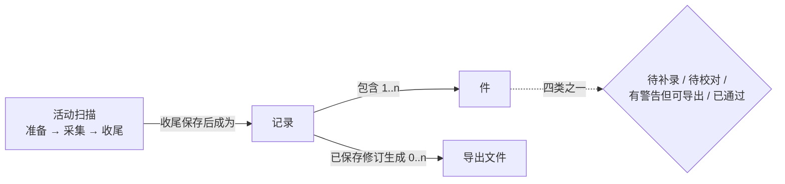
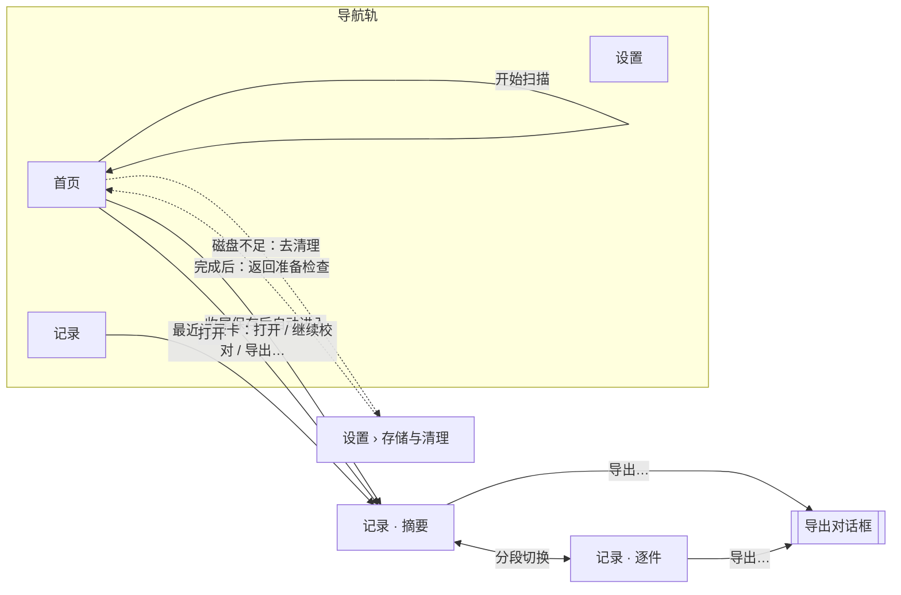

# 07 信息架构与导航

**第二阶段草案**（2026-11-03）。本阶段回答“有哪些页面、怎样互相到达、每个对象放在哪里”。输入是第一阶段的 [06 §1 已决定的提案](06-proposals-and-phase2.md#1-功能提案)和 [06 §3 给第二阶段的输入](06-proposals-and-phase2.md#3-给第二阶段的输入)、[03 Windows 旅程](03-journeys-windows.md)、[05 状态矩阵](05-state-matrix.md)。首版只做 Windows 本地客户端，mac 只是开发平台，界面不为 mac 单独设计（[06 §1.1](06-proposals-and-phase2.md#11-首版范围调整2026-11-03-用户决定)）。

每屏的规格见 [08](08-screens.md)，窗口边界与交互规则见 [09](09-window-and-interaction.md)，对服务层的需求见 [10](10-service-requirements.md)，待用户决定的问题见 [11](11-phase2-open-questions.md)，线框图见 [wireframes/](wireframes/README.md)。

## 1. 核心对象模型

| 对象 | 用户需要知道的属性 | 生命周期与关系 | 在界面上的“家” |
| --- | --- | --- | --- |
| **活动扫描** | 阶段（准备 / 扫描中 / 收尾）、准备倒计时、停止热键、已采集件数（窗口可见时） | 同一时间至多一个（C-22）；收尾保存成功后成为一条记录；准备超时也会留下记录（[架构 §5 生命周期](../../specs/scanner-architecture.md#生命周期)） | 首页的“扫描”区：准备检查与扫描状态共用同一块位置 |
| **记录** | 开始时间、结束类型、覆盖结论、四类计数、可导出数、保存状态、截图占用、扫描耗时 | 再扫生成新记录，不覆盖旧记录（W2-R）；可多次重开、校对、导出；删除要预览影响（C-28）；将来 P-12 可能由多次会话组成（本阶段只预留入口位置） | 记录工作区（摘要 / 逐件两个视图）；首页“最近记录”卡；记录列表 |
| **件** | 序号、套装与号位、四类之一、问题字段、截图 | 属于一条记录；没有跨记录身份（[06 §1.2](06-proposals-and-phase2.md#12-其他产品决定2026-11-03)）；校对只改记录，不操作游戏 | 记录工作区的“逐件”视图 |
| **导出文件** | 格式、文件名、纳入数、排除数、覆盖结论、写入位置 | 由记录的一个已保存修订生成，写入系统下载目录；应用不管理它，清理不删除它（C-27） | 导出对话框；成功后只提供“打开下载目录” |

两条对象层面的设计决定：

- **“扫描”不是一个页面，而是首页上的一块状态区。** 扫描期间用户收不到 youkai 反馈（[06 §3 第 1 条](06-proposals-and-phase2.md#3-给第二阶段的输入)），扫描中的界面只服务于“开始前”和“结束后”。把准备检查、准备倒计时、收尾状态放在同一块位置，用户点开始前看的地方，就是切回 youkai 时看到状态的地方。
- **记录是导航的中心对象。** 结果摘要、校对、导出都挂在一条记录下，不按“扫描 / 校对 / 导出”拆成平行目的地。这样“继续校对”“再导出”只需要先找到记录（W5a、W5b），扫描刚结束和从历史重开走同一套视图。

## 2. 页面与视图清单

| 编号 | 页面 / 视图 | 类型 | 主要承载的旅程 | 规格 |
| --- | --- | --- | --- | --- |
| V1 | **首页**：扫描区（准备检查 → 准备中 → 扫描中 → 收尾）+ 最近记录卡 | 导航目的地 | W5a、W1、W2a、W2b、W2-R | [08 §1](08-screens.md#1-首页准备检查与扫描状态) |
| V2 | **记录 · 摘要**（结果摘要） | 记录工作区视图 | W2c、W2d、W5a | [08 §2](08-screens.md#2-记录--摘要结果摘要) |
| V3 | **记录 · 逐件**（校对与补录） | 记录工作区视图 | W3 | [08 §3](08-screens.md#3-记录--逐件校对与补录) |
| V4 | **导出** | 记录上的模态对话框 | W4 | [08 §4](08-screens.md#4-导出对话框) |
| V5 | **记录列表**（历史） | 导航目的地 | W5b、W6（单条清理） | [08 §5](08-screens.md#5-记录列表历史) |
| V6 | **设置**：常规、快捷键、存储与清理、诊断、更新、关于 | 导航目的地（分节单页） | W6、W7、P-15 | [08 §6](08-screens.md#6-设置与更新) |
| V7 | **托盘菜单** | 系统触点 | W8 | [08 §7](08-screens.md#7-托盘菜单) |
| V8 | **结束通知** | 系统触点 | W2c、W2d | [08 §8](08-screens.md#8-结束通知) |
| V9 | 通用对话框：未保存修改、删除确认、退出失败、首次隐藏提示 | 模态对话框 | F-21、F-26/F-27、C-21、P-10 | [08 §9](08-screens.md#9-通用对话框) |

## 3. 导航模型

### 3.1 结论

**窄导航轨 + 以记录为中心的工作区。** 左侧一条约 64 DIP 宽的导航轨，只有三个目的地：**首页、记录、设置**。从首页或记录列表打开一条记录后进入记录工作区：顶部是记录标题栏（返回“全部记录”、覆盖 / 待处理 / 保存三项状态、“导出…”按钮），下面用分段控件在“摘要”和“逐件”两个视图之间切换。导出是记录上的对话框，不是独立页面。

导航轨上“记录”在进入任何一条记录的工作区时都保持高亮：工作区是记录列表的下钻层，不是第四个目的地。

### 3.2 取舍

| 方案 | 适合的地方 | 不适合的地方（引用旅程） | 结论 |
| --- | --- | --- | --- |
| **向导式**（准备 → 扫描 → 摘要 → 校对 → 导出 逐步前进） | 首次使用的线性感；主干本身是顺序的 | 主干有条件分支：校对只在有待处理件或用户主动检查时进入（W2c 步骤 13，11-02 真机 1,017 件只有 1 件待校对）；回访要求“再扫一次 / 继续校对 / 再导出”同时可达（W5a 步骤 3），向导会把回访者放在第 1 步；历史、设置要随时可进（03 旅程一览）。 | **不采用**整体向导。只在记录工作区里用“下一步”式主按钮引导主干（摘要 → 校对 → 导出），不画步骤条。 |
| **单页分区**（所有内容在一页上分块） | 首页需要让准备检查和最近记录同时可见（W5a + W2-R），使用频率未知时两条路径都不能多走一步（[06 §1.2](06-proposals-and-phase2.md#12-其他产品决定2026-11-03)） | 校对需要证据与表单同时可见、尽量宽（P-11 第②层、[06 §3 第 14 条](06-proposals-and-phase2.md#3-给第二阶段的输入)），无法和准备检查、历史挤在一页 | **只在首页采用**：扫描区与最近记录卡并排。 |
| **宽侧栏**（现有 144/168 DIP，三个并列目的地） | 目的地少、长期可见 | 默认窗口下侧栏吃掉 12–14% 的宽度，而最缺宽度的是校对（现状 H3：默认宽度 1020 比列表与详情的分栏断点 1024 还少 4 px，`internal/ui/results_filter.go:512`）；扫描与校对被放在同一目的地下的两个阶段，从历史重开的记录却在另一个目的地，同一套结果视图有两个家 | **改为窄导航轨**，宽度省给记录工作区；记录工作区只有一个家。 |
| **顶部标签栏** | 不占宽度 | 125% 缩放、1080p 显示器上工作区只有约 816 DIP 高（[09 §1](09-window-and-interaction.md#1-窗口硬边界)），高度比宽度更紧；校对的截图区是竖排的逐行裁剪列表，也需要高度 | 不采用。 |

这个结论和现有外壳都是三个目的地，但含义不同：现有的“扫描”目的地同时承载准备和校对，“历史”只是列表；新结构里“首页”只管开始前和最近一条，“记录”承载全部结果相关的工作。P-11 要求的“由旅程重新证明”见上表。

### 3.3 MyGo 实现依据

已核对 `github.com/egoist/mygo@v0.6.2` 源码（`ui/api_gen.go` 的公开控件列表）：导航轨可用 `Column` + `Toggle`/`Button` 组合，不依赖 `Sidebar` 的宽度；分段控件有 `Segmented`；记录工作区的可拖分栏有 `Split`（分隔条距两边至少 40 DIP，空间不足时第一栏让出，`ui/api_gen.go` 中 `Split` 的说明）；对话框有 `Modal`、`AlertDialog`；折叠区有 `Collapsible`、`Accordion`；日期筛选有 `DateInput`、`Calendar`。表格仍用 `Table`。界面语言可用 `App.SetLanguages`、`App.SetLocale` 固定为简体中文（`locale.go:83`、`:147`），解决现状 M3 的控件英文问题。

## 4. 各种情况的入口

| 情况 | 入口 | 落点与默认焦点 | 旅程 / 状态 |
| --- | --- | --- | --- |
| **首次进入**（没有任何记录） | 启动 youkai | 首页。扫描区展开准备检查，每项附一句“为什么需要”；最近记录卡显示空状态“完成第一次扫描后，结果会显示在这里”。焦点在第一个不满足项的操作上；全部满足时在“开始扫描”。 | W1、S1 首次启动、S2 |
| **回访** | 启动 youkai、从托盘打开、再次双击图标 | 首页。最近记录卡显示上次的日期、覆盖、待处理数、可导出数；准备检查默认精简为一行结论（“可以开始”或“2 项需要处理”）加不满足项，已满足项折叠。焦点在“开始扫描”（就绪时）或第一个不满足项。 | W5a、S1 回访 |
| **再扫** | 首页“开始扫描” | 扫描区进入准备中；收尾保存后自动进入新记录的摘要。旧记录不变。 | W2-R、S2→S6 |
| **扫描结束后回来** | 点击结束通知、托盘“打开 youkai”、任务栏按钮 | 新记录的摘要（收尾已完成）；收尾未完成时停在首页扫描区的收尾状态，完成后自动进入摘要。 | W2c 步骤 9–11、S5、S6 |
| **继续校对** | 首页最近记录卡“继续校对（n 件）”；记录列表 → 打开 → “逐件” | 记录 · 逐件，筛选为“待处理”，选中第一件待处理件，焦点在其第一个问题字段。 | W5a、W5b、W3、S7 |
| **再导出** | 首页最近记录卡“导出…”；记录工作区标题栏“导出…”（任一视图） | 导出对话框，焦点在第一个格式按钮。 | W4、S8 |
| **诊断** | 故障结束摘要的“诊断信息”折叠区；设置 › 诊断；更新失败、退出失败的对话框 | 同一组操作：“复制诊断信息”“打开诊断目录”。 | P-15、S6 故障结束、S10、S11 |
| **磁盘不足** | 准备检查“磁盘空间”一项的“去清理” | 设置 › 存储与清理，顶部带“完成后返回准备检查”。 | W6、S2 磁盘不足 |
| **更新** | 发现新版本时导航轨“设置”上的圆点；设置 › 更新 | 设置 › 更新。 | W7、S10 |

## 5. 对已认可示意图的取舍

第一阶段的低保真示意图（[sketches/](sketches/)，由 Kimi 绘制，用户已认可其旅程与信息层级）保留了以下判断：主干从回访开始、首次使用汇入同一份准备检查（01）；点开始后 youkai 留在原地、扫描中无反馈、结束靠通知（02）；准备检查每项写“当前值 → 需要值”（03）；结果摘要先看覆盖与待校对再决定下一步（04）；证据与表单同时可见（05）；结束时不询问截图（06）。

以下几处在布局上推翻或修改，理由如下：

| 示意图 | 原画法 | 本阶段的做法 | 理由 |
| --- | --- | --- | --- |
| 03 准备检查 | “游戏页面：驱动盘仓库”“扫描范围”作为开始前的检查项，8 项等高平铺 | 页面检查标为“开始后检查”（不给就绪 / 未就绪结论）；扫描范围、保存位置改为说明文字，不算检查项；新增 DPI 与磁盘空间两项；回访时已满足项折叠 | 页面、遮挡、独占全屏需要游戏在前台才能检查（P-03 的代价列、S2“开始后检查”）；范围是事实不是条件；DPI 与磁盘是 S2/S3 的真实失败项（C-12、C-28）。回访者只需要看结论和例外（W5a 步骤 1 风险）。 |
| 04 结果摘要（第一张） | “导出 JSON”实心主按钮、“导出 CSV”描边 | 摘要上只有一个“导出…”入口；在导出对话框里 JSON 与 CSV 并列、同等权重 | 规格要求两个并列入口、无默认格式（F-22、W4 步骤 1）。 |
| 04 结果摘要（第三张） | 部分覆盖时主按钮为“重扫不完整位置（3、5）” | 首版主按钮按待处理件决定（校对或导出），“重新扫描”为次要按钮；P-12 入口只在布局中预留位置 | P-12 只采纳为方向，首版不实现（06 P-12、[06 §3 第 4 条](06-proposals-and-phase2.md#3-给第二阶段的输入)）。 |
| 05 校对 | 列表 / 证据 / 表单三栏等宽；列表行是卡片；证据是整张游戏详情截图并画框 | 默认窗口三栏（列表约 240 DIP）；最小窗口时列表收进顶部导航条和弹出列表，证据与表单始终并排；证据区改为逐行裁剪列表 | 默认窗口放不下三张宽卡片；P-11 第②层只要求证据与表单同时可见，列表可以让位（[09 §2](09-window-and-interaction.md#2-窄宽度降级)）。现有证据没有整块详情面板图，只有逐行裁剪（[10 R-07a](10-service-requirements.md#r-07a-行裁剪与表单字段的对应)）；是否补采面板图见 [11 Q-03](11-phase2-open-questions.md#q-03-是否采集详情面板图)。 |
| 06 截图处理 | 结果摘要上一张“截图已默认保留”的提示卡 | 不放提示卡；截图占用写在摘要的“详情”折叠区，删除入口出现在校对完成、导出成功后和设置 › 存储与清理 | 结束时不打断（P-13）已经做到，再放提示卡会占用首屏层级；有待校对项时不应主动建议删除截图（P-13 代价列）。 |
