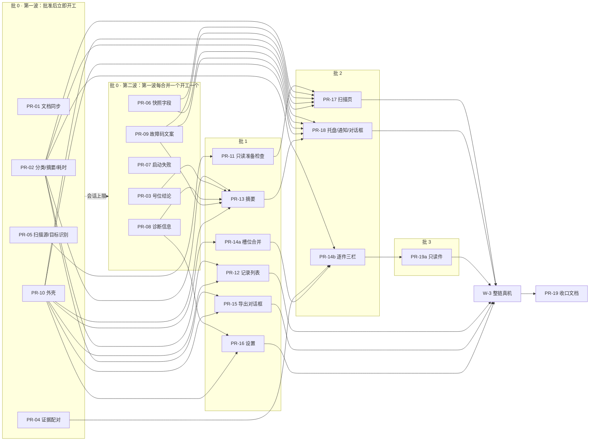

# 12 第三阶段：实施拆分计划

**定稿（2026-11-05 用户批准）。** 用户原话：“都按推荐，两处调整也采纳。你合理安排可并行的内容即可”。§8 的三个问题都按推荐决定；主控的两处调整（批 0 分两波、PR-14 拆成 PR-14a / PR-14b）已经写进正文。基线：`main` = `5ae58ce`。本文由 PR-01 提交到 `docs/design/uiux-2026-11/12-implementation-plan.md`。

写法约定：**事实**带 `file:line` 或文档出处；**推断 / 建议**明确标注。R / D / L / P / F / T 编号沿用 `docs/design/uiux-2026-11/`（01、06、08、09、10、11）。PR 编号是本计划的临时编号（`PR-xx`），合并后由主控换成 GitHub 编号。

---

## 0. 结论速览

- **PR 共 21 个**：服务层 / 契约 9 个，界面 10 个，文档 2 个；另有 2 项 Windows 实测任务 W-1、W-3（不产生代码，结论随文档 PR 落盘）。P-04、P-05 的实测放到首版之后（Q-C）。
- **批次**：批 0 有 10 个 PR，分两波开工：第一波 PR-01、PR-02、PR-04、PR-05、PR-10；第二波 PR-03、PR-06、PR-07、PR-08、PR-09，第一波任一 PR 合并后就陆续开工。批 1 6 个，批 2 3 个，批 3 1 个（PR-19a），最后是收口（W-3 整链真机验收 + PR-19 文档）。**同时进行的实现会话不超过 5 个**（§4）。
- **两条并列的关键路径**：
  - 平台线：PR-05 安装版扫描源与目标识别 → PR-11 只读准备检查 → PR-17 扫描页，三段都要 Windows 真机验证；
  - 界面线：PR-10 外壳 → PR-14a 槽位合并 → PR-14b 逐件三栏 → PR-19a 只读件。

  两条线都通向 W-3 → PR-19（推断工期见 §4）。
- **服务层先行，单独成 PR**（理由见 §2.2）。界面 PR 只消费已经合并的快照或契约字段，各自删除它替换掉的旧界面，不另开“删除旧 UI”的 PR。
- **用户决定（2026-11-05）**（§8）：Q-A 本计划接入安装版扫描源；Q-B 停止热键在准备检查里固定为“点开始后检查”，不试注册；Q-C 只做 P-02 的只读实测 W-1，P-04、P-05 放到首版之后。
- **分工**：实现用 Evelyn，只读评审用 Sunna，Windows 真机验证用 Cissia（§2.4）。

---

## 1. 现状要点（影响拆分的事实）

| # | 事实 | 出处 | 对计划的影响 |
| --- | --- | --- | --- |
| E1 | 安装版没有扫描源：入口不设环境变量时返回 `nil` 源，界面写“当前安装版没有接入扫描源…” | `cmd/youkai/main.go:208`、`:479-494` | D-01 / P-01 是扫描页能用的前提，必须先做（PR-05） |
| E2 | Windows 目标身份只按可执行文件**完整路径**匹配，路径必须由 `YOUKAI_GAME_EXE` 给出，缺了就拒绝接线 | `internal/platform/windows/identity.go:72-88`、`cmd/youkai/main.go:523-527` | 自动识别（P-01）需要新增“按进程映像名枚举候选窗口”；真机已记录进程 `ZenlessZoneZero.exe`、窗口类 `UnityWndClass`（`docs/reports/2026-11-02-windows-local-field-acceptance.md:19`） |
| E3 | 平台端口有意不提供停止热键的可注册性探测：热键在 `Open` 中注册，一直持有到 `Close`；注释说明两个平台都没有无副作用的探测，“注册—注销—再注册”会留下被其他进程抢占的空档 | `internal/platform/port.go:26-36` | 与 08 §1.1 的“停止热键：被占用 → 可注册”一行冲突（R-01 已提示）；Q-B 已决定：固定为“点开始后检查”，PR-01 同步 08 §1.1 |
| E4 | Windows 预检已分两段：第 1 段（档位、屏幕包含、DPI、完整性级别）不需要游戏在前台，第 2 段在切回游戏之后 | `internal/platform/winprecheck.go:12-20`、`internal/platform/winadapter.go:127`、`:140` | R-01 可以复用第 1 段的判定函数，不必新写判定逻辑；但现在第 1 段只能在 `Open` 内部、注册热键之后运行，需要把它拆出来 |
| E5 | 记录列表已经通过 `Peek` 读取每条记录的检查点（不哈希证据），并算出覆盖、待校对、可导出等计数 | `internal/app/history.go:10-16`、`:62-81` | R-06 不是从零开始。缺的是：开始 / 结束时间与耗时、“有警告”一类、不完整号位数、中断恢复状态 |
| E6 | 四类分类目前在界面层，没有“有警告但可导出”这一类 | `internal/ui/counts.go:29-46`；app 层另有 `itemPendingReview`、`usableItem`（`internal/app/cleanup.go:247`、`internal/app/export.go:261`）和 `Warnings`（`internal/app/review.go:81-83`） | R-08 应在 app 层统一一个判定函数，界面、导出、通知共用 |
| E7 | 号位账目**已有**：遍历把每个号位的 `complete/stage/reasonCode/reason` 写进 `observedScope.positions`，界面层自己解析 | `internal/game/zzz/collect/inventory.go:323`、`:493-503`；`internal/ui/session_status.go:12-40`；记录层把它当作不透明 JSON（`internal/record/checkpoint.go:264-269`） | **修正 10 R-10 的“现状：无”**：要做的是把它提升为记录层的稳定契约，并兼容没有该字段的旧记录，不需要新建采集逻辑 |
| E8 | 证据按下标配对：界面把第 i 行配给第 i 个证据 ID，而写入会跳过空图和失败的图 | 10 R-07a 已列出（`internal/ui/results_view.go:1272-1273`、`internal/app/deliverer.go:242-250`） | 这是现有的错位缺陷，P0，单独成小 PR（PR-04） |
| E9 | 窗口默认 1020×700、最小 860×560；没有启用 `StateKey`；没有调用 `SetLanguages/SetLocale`、通知或 `FlashFrame` | `cmd/youkai/main.go:304-310`；在 `cmd/`、`internal/` 中 grep 无结果 | R-12、R-15 和窗口尺寸放进外壳 PR；通知整体新做 |
| E10 | 现有外壳：宽侧栏 168/144 DIP；`pageAuto` 有记录时自动落在结果页或历史页；结果有“会话 / 历史”两个槽位 | `internal/ui/pages.go:13-50`、`:85-99`；`internal/ui/resultslots.go:9-30` | 外壳 PR 删除侧栏与 `pageAuto` 的落点逻辑；槽位的合并单独做（PR-14a） |
| E11 | 扫描结束后的“保留截图 / 删除截图 / 稍后处理”提示仍在 | `internal/ui/cleanup.go:32`、`:124`、`:191` | 与 P-13 冲突；由摘要 PR 删除，规格同时改 |
| E12 | 托盘菜单固定为“打开主窗口 / 停止扫描 / 退出”；左键单击 → 恢复（#115） | `cmd/youkai/lifecycle.go:174`、`:343-349` | 托盘状态化（08 §7）放进托盘与通知 PR；左键行为在 P-02 实测前不改 |
| E13 | 准备阶段的激活与截止时间只存在于控制器的局部变量 | `internal/game/zzz/collect/controller.go:192-198`、`:259` | R-02 要把它们写进内核快照 |

---

## 2. 拆分原则与取舍

### 2.1 拆分原则

1. **一个 PR 只交付一个能独立验收的结果**：一份契约、一个屏，或一组同屏状态。界面 PR 合并后 `main` 必须仍然可用：被替换的旧界面在同一个 PR 里删除，不留两套并存。
2. **批内并行、批间串行，不堆叠 PR**：依赖的 PR 等前置合并后从新的 `main` 开始。同批 PR 尽量不改同一个文件；无法避免时在 PR 说明里写清“合并时需要并入 main 的区域”。
3. **复用优先**：保存、修订、导出、清理、更新、生命周期的服务层与测试照常复用；界面 PR 只重写布局和展示层。
4. **不做设计以外的重构**：现状评审里的 S1–S4（巨型 Model、文案分散等）不单列 PR，只在各屏 PR 为了落地必须拆文件时顺手拆。

### 2.2 服务层 / 契约改动：先行还是和界面合在一起

**结论：凡是改快照、记录或平台契约的，都单独成 PR 并放在批 0 / 批 1；只服务单个界面、并且只在界面层的数据整理（R-07a 映射、R-05 文案表、R-14 中界面自己知道的那部分）也单独先行，或者并进该界面 PR。**

| 需求 | 处理 | 理由 |
| --- | --- | --- |
| R-08 分类、R-06 摘要、R-04 耗时 | **单独先行**（PR-02） | 摘要、逐件、记录列表、导出、通知 5 个界面 PR 都要用。放进任何一个界面 PR，其他 4 个都得等它；单独做可以用 `go test` 独立验收，也不和外壳冲突 |
| R-10 号位结论 | **单独先行**（PR-03） | 改记录契约，要兼容旧记录（E7），风险集中在 record / collect，和界面无关 |
| R-07a 证据配对与角色映射 | **单独先行**（PR-04） | 它是现有缺陷（E8），值得马上修；逐件 PR 已经是 L 级，拆出来能减小它的体量 |
| R-01 只读准备检查 | **单独做**（PR-11），排在 PR-05 之后 | 平台层改动最大，并且需要真机；放进扫描页 PR，会让真机问题和界面问题混在同一轮评审里 |
| D-01 / P-01 扫描源与目标识别 | **单独先行**（PR-05） | R-01 的第一项“目标客户端”依赖候选枚举；入口接线和平台枚举可以独立在真机上验证 |
| R-02、R-09、R-14（服务部分） | **合成一个快照 PR**（PR-06） | 都是给 `Snapshot` / `scan.Snapshot` 加字段，改同一组文件；拆开反而互相冲突 |
| R-19 启动失败提示 | **单独做**（PR-07） | 只改 `cmd/youkai` 的启动顺序，与界面无关 |
| R-13 诊断信息 | **单独做**（PR-08） | 摘要、设置、退出失败三处共用 |
| R-05 故障码文案 | **单独先行**（PR-09） | 文案表留在 `internal/ui`（现有 `session_status.go:87-170`），通知文字也由 ui 包组装，所以不新建包。要先在 T2 补上 `dpiVirtualized`、`dpiCheckUnavailable` 的处理方法 |
| R-12、R-15 | 并进外壳 PR（PR-10） | 只在窗口创建与 App 初始化处各改几行 |
| R-18 | 并进托盘与通知 PR（PR-18） | 只给设置加一个布尔字段 |
| R-11（P2） | **首版只显示“已采集 n 件”**，不做当前号位 | 计数已在 `scan.Snapshot` 中；当前号位要改遍历，收益只出现在 4K 并排时（09 §1.1）。建议：放到后续版本 |
| R-03、R-17 | 不进本计划 | P-04、P-05 的实测与实现放到首版之后（Q-C 已决定） |
| R-16、R-07b | 不做 | 已定为“方向” / “首版不做” |

**代价（推断）**：批 0 的服务层 PR 合并之前，界面 PR 只能开工外壳。所以批 0 要尽快把 PR-02 合进去：它是 PR-12、PR-13、PR-14b、PR-15、PR-17、PR-18 共 6 个界面 PR 的共同前置。

### 2.3 R-06 的实现方式（技术取舍，不提交给用户）

10 R-06 写的是“需要在保存时写一份摘要（或建立索引）”。E5 表明现在已经用 `Peek` 逐条读取。建议 PR-02 **先在 `Peek` 的结果上补齐字段**，不新增摘要文件；用现有的 1,000 / 10,000 件合成规模测试（M3 第 10 项、`internal/app/export_scale_test.go`）加一个“50 条记录 × 1,000 件”的列表耗时基准。只有在超出预算时，才在保存检查点时写侧车摘要。理由：少一份要和检查点保持一致的派生数据，删除与恢复路径不变。预算建议值是在 Mac 开发机上 < 300 ms（推断，PR-02 实测后写进 T6 §5 的性能行）。

### 2.4 分工（Lody 角色）

按 `~/.agents/docs/lody.md` 的交付流程：

| 角色 | 用途 | 约束 |
| --- | --- | --- |
| **Evelyn** | 每个 PR 一个独立的实现会话，在隔离 worktree 里开发 | 在 Mac 上开发；从最新的 `main` 开始，不堆叠 PR；完成后列出自己创建的临时文件 |
| **Sunna** | 每轮评审一个独立的只读会话，评审实现会话的 worktree，给出带 `file:line` 的问题 | 只读；两轮修复后仍有问题就停下来，由主控报告用户 |
| **Cissia** | Windows 真机验证（§6 中标明“Cissia 真机”的项，以及 W-1、W-3） | 只拉取指定分支、构建和运行，**不改代码**；临时脚本用完就删 |

主控只负责计划、派发、合并和清理，不参与实现。每个 PR squash 合并。

---

## 3. PR 清单

规模：S ≈ 1–2 天，M ≈ 3–5 天，L ≈ 1–2 周（推断，含评审轮次）。“检查”一栏默认都要过：`gofmt`、`go vet ./...`、`go test ./...`、`go tool mygo vet .`（macOS），涉及并发的包加 `go test -race ./internal/app ./internal/scan ./internal/record ./internal/ui`（`docs/specs/scanner-implementation-plan.md:160-165`）。下表只写各 PR 额外要满足的项。

### 批 0（分两波）

第一波：PR-01、PR-02、PR-04、PR-05、PR-10，计划批准后立即开工（5 个实现会话）。第二波：PR-03、PR-06、PR-07、PR-08、PR-09，第一波的 PR 每合并一个，就开工一个，同时进行的实现会话始终不超过 5 个。第二波的 PR 本身没有前置依赖，排在第二波只是因为会话上限；建议的开工顺序见 §4。

#### PR-01 文档：第一阶段原文与 T6 / T1 / 架构的展示条款同步
- **目标**：让规格反映已定稿的设计，此后界面 PR 有一个可以引用的权威来源。
- **范围**：
  - 01 / 03 / 05 / 06 中被 07 开头与 08 §3.1 覆盖的段落，改成指向 07 / 08（F-18 的“上下文截图”、05 S1 回访的最近记录、S7“查看一件”、06 §3 第 3、13、14 条），不重写正文。
  - T6 第 5 行“2026-10-23 当前 UI 外壳”与 §1 第 9 行（侧栏、三个并列目的地）、§3 第 79 行（1440 / 1020 / 860 的列显隐）改为：“界面布局与导航以 `design/uiux-2026-11/07–09` 为准；本文只维护数据与流程契约”（P-11 第①层）。
  - T6 §1 删除“开始并隐藏”（P-09），“保存完成”一行改为 P-13；修正 §1 第 11 行的起点（D-12，以 T5 为准）。
  - T1 §1 详情区的“上下文截图”改为“逐行裁剪 + `Context` 裁剪”（Q-06 选 A）。
  - 架构 §5 清理约束第 1 条与本地目录段首句改为 P-13。
  - **Q-B 的决定**：08 §1.1 检查清单中的“停止热键”一行改为与“游戏页面、遮挡、独占全屏”同类，结论固定为“点开始后检查”；开始后注册失败（`hotkeyUnavailable`）时回到清单，并把这一项置顶展开。10 R-01 中“停止热键‘可注册’只能通过试注册再释放得到…”一条，改为“不试注册：平台端口在 `Open` 时注册、到 `Close` 才释放（`internal/platform/port.go:26-36`），只读检查对这一项只给出‘点开始后检查’”；“项目至少包括”中的“停止热键可注册”同步删除。08 §1 规格表的“键盘与焦点”“对应状态”如果引用了这一项，一并核对。
  - 10 的现状列按事实修正（§7 末段：R-06、R-10 改为“部分”）。
  - 本计划作为 `docs/design/uiux-2026-11/12-implementation-plan.md` 提交；`README.md` 的文件列表与 07 开头的文档导航加上 12。
  - 实施清单 M3 第 8 项注明“结束时提示”被 P-13 取代；M3 段首加上对 12 的引用。
  - `docs/index.md`：第二阶段条目去掉“草案”和“定稿后再同步”，新增第三阶段条目（指向 12）。
- **不做**：不改数据契约（JSON/CSV、保存、修订）。条款里凡是描述实现现状的，统一加“实现状态：随 PR-xx 落地”，等对应界面 PR 合并时再删去这句标注（见 §4）。
- **验收**：文档内的链接锚点全部能解析（主控用现有方式检查；仓库没有链接检查脚本）；独立评审逐条核对 07 开头列出的覆盖清单都已落到原文。
- **依赖**：无。第一波。**规模** M。**风险**：和后续 PR 的规格改动在同一段落相撞。缓解：约定 PR-01 只改“展示 / 导航”句子，契约句子由各服务层 PR 改。

#### PR-02 服务层：四类分类、记录摘要与预计耗时（R-08、R-06、R-04）
- **目标**：app 层提供一个分类判定和一份列表级摘要，界面、导出、通知统一使用。
- **范围**：`internal/app`：新的分类函数，按“处理结局 → validation → quality → warning”的顺序（README 术语、F-16）给出“待补录（识别失败 / 未处理）/ 待校对 / 有警告 / 已通过”，以及“待处理”合计；复用 `itemPendingReview`、`usableItem`、`Warnings`（E6）。`HistoryRecord` 增加 `StartedAt`、`EndedAt`、四类计数、不完整号位数（PR-03 合并前留 0 并标注“未知”）、中断恢复标记。新增“最近 3 次正常结束且覆盖全部”的耗时中位数与依据次数（09 §4.8）。导出的纳入 / 排除计数改用同一判定。
- **不做**：不改界面（`internal/ui/counts.go` 由 PR-13 / PR-14b 切换过去）；不新增摘要文件（§2.3）；不按档位过滤预计耗时（首版只有一档，10 R-04 注明以后再加）。
- **规格**：T6 §2 写入四类定义与判定顺序（把 design README 术语搬进 T6，README 改成引用，保持单一来源）；架构 §5“完整性与身份”的计数行补“有警告”；JSON/CSV 不变（警告件本来就纳入导出）。
- **验收**：表驱动测试覆盖每一类和判定顺序的边界（警告件同时有资料缺口时归“待校对”）；分类结果与导出纳入数逐件一致（复用 `internal/app/export_test.go` 的夹具）；耗时中位数在 0、1、3、5 条历史时的值，以及“手动停止 / 部分覆盖不计入”；列表耗时基准（§2.3）。
- **依赖**：无。第一波。**规模** M。**风险**：旧记录缺 `EndedAt`（`checkpoint.go:271` 为可选）时，耗时要算作未知，不能当 0。

#### PR-03 契约：号位级结论进入记录（R-10）
- **目标**：记录给出稳定的“号位 → 结论 + 原因码 + 排序是否验证”，摘要和通知不再解析不透明的 `observedScope`。
- **范围**：`internal/record` 增加号位结论结构（号位 1–6、`complete`、阶段、原因码），由收尾时从遍历的 `positionScope` 写入（E7）；旧记录没有这个字段时，从 `observedScope.positions` 回读一次（与现在 `session_status.go:24-40` 的读法一致），读不出就记为“无法列出”。`internal/app` 在摘要（PR-02 的字段）里给出不完整号位列表。
- **不做**：不改遍历判定，也不新增原因码（阶段 3 / 5 的排序标签与位置重建仍按 T5）；不改 JSON/CSV v2。
- **规格**：架构 §5“保存内容 · 会话外壳”一行补号位结论；T5 §6“保存什么证据”指向它。检查点格式版本按 record 现有约定处理（要不要升版本由实现会话判断，并写进 PR 说明）。
- **验收**：新旧检查点都能读出号位结论（夹具：带 `observedScope.positions` 的旧检查点、完全没有 scope 的检查点）；不完整号位数和覆盖结论一致（`complete` 只在 6 个号位都完整且排序已验证时成立，`inventory.go:503`）。
- **依赖**：无；第二波。（PR-02 先合并时，在本 PR 里把 `HistoryRecord` 的不完整号位数接上；否则由 PR-02 接）。**规模** M。**风险**：检查点版本兼容。

#### PR-04 修复：证据按 ID 配对与行角色 → 表单字段映射（R-07a）
- **目标**：每张行裁剪准确对应它的字段；`Context` 裁剪可以读取。
- **范围**：`internal/ui/recordview.go` 按证据 ID 中的 `line<i>` / `context<i>` 配对（`deliverer.go:581-590`），取代按下标配对；补读 `context` 角色；新增“角色 → 表单字段”映射表（`name`→套装、`level`→等级、`main`→主词条、`subN`→副词条 N、装备者 → 头像裁剪、管理状态 → 无截图），供 PR-14b 使用。当前结果页的证据显示改用新的配对结果（只是修错位，不改布局）。
- **不做**：不改证据写入（app 层继续不解释角色，`payload.go:30-36`）；不做截图区的新布局。
- **规格**：T6 §2“点选字段可以定位其证据区域”后面补一句“定位依据是行角色，角色缺失时按采集顺序列出”（R-07a 的退路）。
- **验收**：单测覆盖跳过空图、写入失败、缺角色、旧记录四种情况，配对都不错位；`recordview_test.go` 现有用例通过。
- **依赖**：无。第一波；它和 PR-10 都改 `internal/ui`，但文件不重叠（PR-10 不碰 recordview / results_view 的证据部分）。**规模** S。**风险**：低。

#### PR-05 安装版扫描源与 Windows 目标自动识别（D-01、P-01；Q-A 已决定接入）
- **目标**：Windows 安装版不设环境变量也能扫描；程序自动找到《绝区零》本地客户端的窗口，有多个候选时交给用户选择。
- **范围**：`internal/platform/windows`：按进程映像名 `ZenlessZoneZero.exe` 枚举可见的顶层窗口候选（类名 `UnityWndClass` 作为筛选提示，E2），返回候选列表（窗口句柄、PID、可执行文件路径、启动时间），不读取外部窗口标题以外的内容；`TargetSpec` 保持按路径锁定，选中的候选转成它的完整路径 + 句柄提示。`internal/app`：`StartRequest` 携带用户确认的目标候选；`GameScanSource` 不再要求预先配置路径。`cmd/youkai/main.go`：Windows 上没有设环境变量时默认 `traverse` + 本地客户端；`YOUKAI_GAME_EXE` 等保留为开发覆盖项，并更新 `development.md`。`main.go:208` 的开发用说明不再出现在安装版界面里（P-01）。
- **不做**：不做准备检查清单（PR-11）；不做客户端选择的新界面——多候选时先在现有扫描区放一个最小的单选列表，PR-17 再按 08 §1.1 重做；不接云客户端；macOS 行为不变（开发平台）。
- **规格**：架构 §6“操作起点”和 T2 §3.2 补“目标识别：按映像名枚举，唯一候选也要确认，多候选由用户选择”；实施清单 M2 第 1 项补 Windows 本地客户端的窗口身份；`development.md` 环境变量一节。
- **验收**：单测（假的进程 / 窗口枚举）覆盖 0 / 1 / 2 个候选、候选在确认后消失、同名进程不同路径；**Cissia 真机**：① 不设任何环境变量启动 dev 构建，游戏已运行 → 找到 1 个候选；② 游戏未运行 → 写“未找到”；③ 确认后开始，扫一个号位后用热键停止，记录正常保存；④ 日志里没有外部窗口标题。
- **依赖**：无。第一波；与 PR-07、PR-10 都改 `main.go`（`scanSource` 与启动顺序是不同区域）。**规模** M。**风险**：映像名识别对改名、第三方启动器的子进程是否稳定（真机只见过一种安装路径，推断）；正式渠道 `v*` 仍按 T7 / M4 的门槛发布（Q-A）。

#### PR-06 快照：准备截止与激活结果、通知边沿、开始受阻原因（R-02、R-09、R-14）
- **目标**：界面和通知需要的活动扫描状态都由服务快照给出，不再从日志或界面推断。
- **范围**：`internal/scan` / `internal/game/zzz/collect`：把准备截止时刻、激活请求结果（已切到前台 / 被拒）写进内核快照（E13）；`internal/app` 的 `Snapshot` 增加“本会话是否开放过输入”“本次收尾的保存失败次数”（R-09），以及开始受阻原因的枚举：收尾中 / 待重试保存 / 安装更新中 / 退出中（R-14；导出、校对保存进行中由界面自己知道）。
- **不做**：不做逐项等待原因（R-03）；不做通知发送（PR-18）；不做当前号位（R-11）。
- **规格**：架构 §5 生命周期表“准备”一行补“快照给出截止时刻与激活结果”；“隐藏、恢复与退出”补“首次保存失败才通知”的服务语义（Q-04 选 A）。
- **验收**：内核测试：准备超时的会话“开放过输入”为假；激活被拒能在快照里看到；同一次收尾连续两次保存失败，计数为 1、2；`-race` 通过。
- **依赖**：无；第二波。**规模** M。**风险**：快照修订号的语义（`service.go:483-506`）不能因为倒计时而每秒自增——快照只给截止时刻，倒计时由界面自己算。

#### PR-07 启动失败的用户可见提示（R-19）
- **目标**：数据根被另一个 youkai 占用或无法打开时，弹出提示再退出，不再“双击没反应”。
- **范围**：`cmd/youkai/main.go:81-91`：区分“被另一进程占用”和“其他错误”（`app.AcquireDataRootLock` 返回可区分的错误）；推荐用 Windows 原生 `MessageBoxW`（不依赖 `App.Run`，规避 `Dialog.Error` 在 Run 之前调用会 panic，08 §10），macOS 只写日志（开发平台）。文案按 08 §10。
- **不做**：不调整单实例转交的顺序（`main.go:85-87` 的语义不变）。
- **规格**：架构 §5“跨进程占用”第 1 条补“显示原因并退出，两种文案”。
- **验收**：单测覆盖错误分类；Mac 上用另一个进程持有锁，确认退出码与日志；**Cissia 可选**：同时运行两份不同单实例身份的构建，看到提示框。
- **依赖**：无；第二波。**规模** S。**风险**：选 `MessageBoxW` 还是“先 `App.Run`、在 `WhenReady` 里报错”，由实现会话判断，PR 说明写清取舍。

#### PR-08 诊断信息组装（R-13）
- **目标**：“复制诊断信息”得到一段可读、不含隐私的文本，“打开诊断目录”可用。
- **范围**：`internal/app/diaglog.go` 旁新增组装函数：版本、系统版本、显示配置、最近一次扫描的结束类型、故障码、首个触发与阶段；**不含外部窗口标题**（T2 §3.2）。
- **不做**：界面入口（PR-13、PR-16、PR-18 接入）；上传。
- **规格**：T6（或开发指南的诊断日志一节）补“复制诊断信息的内容清单”，二者选一，另一处引用。
- **验收**：单测断言输出里不含任何窗口标题和用户名路径片段；Windows 与 Mac 都有输出。
- **依赖**：无；第二波。**规模** S。**风险**：低。

#### PR-09 故障码的中文原因与处理方法（R-05、D-04）
- **目标**：所有故障码都有“原因 + 怎么做 + 出口”，准备检查、摘要、通知、诊断共用一张表。
- **范围**：`internal/ui/session_status.go:87-170` 的 `failureText` 扩成完整的映射表，覆盖 T2 §3.2 故障码表与 05 S3 / S6 中出现的码；每项给出“出口”（对应的检查项 / 去清理 / 复制诊断信息）。补全测试，让表与 `internal/platform/fault.go`、`internal/platform/windows/fault.go` 中定义的码对齐（漏一个码测试就失败）。
- **不做**：不改界面布局。
- **规格**：T2 §3.2 补 `dpiVirtualized`、`dpiCheckUnavailable` 的用户处理方法（S3 待定行）；文案正文只在代码表里维护，T2 只写“处理方法”的原则，避免两处各写一份。
- **验收**：码表完整性测试；界面上不出现英文码（诊断信息除外）。
- **依赖**：无；第二波。**规模** S。**风险**：两条 DPI 文案需要主控确认措辞（不是用户决定，是文案细节）。

#### PR-10 外壳：窄导航轨、记录工作区骨架、窗口尺寸、中文控件、记住窗口位置（07 §3、09 §1–2、R-12、R-15、09 §4.5）
- **目标**：新的导航结构上线，现有各屏先装进新结构，之后每个屏 PR 只替换自己那一块。
- **范围**：
  - `internal/ui/pages.go`：删除宽侧栏（`sidebarWideWidth`、`sidebarNarrowWidth`、`sidebarWidth`，`:21-27`、`:85-99`）和 `pageAuto` 的落点逻辑（`:37-50`）；新的 64 DIP 导航轨（`Column` + `Toggle`/`Button`）只有扫描 / 记录 / 设置；启动落在扫描页。
  - 记录工作区：标题栏（返回“全部记录”、三项状态占位、“导出…”）+ `Segmented`“摘要 / 逐件”。本 PR 里“逐件”装现有结果视图，“摘要”先放现有结果头部的结论区；导航轨的“记录”在工作区里保持高亮。
  - 收尾保存后自动进入新记录的摘要（只切换视图，不激活窗口，C-09）。
  - `cmd/youkai/main.go:304-310`：默认 1180×760、最小 960×640；工作区更小时按 09 §1 取 92%；`StateKey`（R-12）；`App.SetLanguages("zh-Hans")`（R-15）。
  - 快捷键显示文字集中在一处，按 Windows 写法（`Ctrl+…`），去掉 `⌘` 符号（D-02、`pages.go:301-304`、`settings_view.go:125-131`）；新增 `Ctrl+E`、`F6` 的注册骨架。
- **不做**：不重做任何一屏的内容；不合并“会话 / 历史”两个结果槽位（PR-14a 做）；不做托盘。
- **规格**：无（布局权威已由 PR-01 交给 07–09）。PR-01 若先合并，删掉 T6 里“实现状态：随 PR-10”的标注。
- **验收**：视图测试：三个目的地的 Tab 顺序（导航轨永远是第一组，09 §4.4）、启动落点、收尾后自动进入摘要、工作区里“记录”高亮；`pages_test.go`、`view_test.go` 按新结构改写；Mac 截图：1180×760、960×640 各一张，与线框 01、05 对照；**Cissia 真机**：4K + 125% 下默认窗口尺寸、最小尺寸；MyGo 内置控件（搜索框、日期）显示中文；关闭再打开后窗口位置恢复。
- **依赖**：无；第一波（建议 PR-01 先合并或同时合并）。**规模** L。**风险**：`model.go`（1,025 行）、`pages_test.go`（1,139 行）、`view_test.go`（1,185 行）改动大，批 1、批 2 的界面 PR 全部依赖它，是界面线的起点。缓解：本 PR 只搭结构，不改各屏内部，并尽快合并。

### 批 1（前置合并后从新的 main 开工）

PR-11、PR-12、PR-13、PR-14a、PR-15、PR-16 属于批 1。PR-14b 依赖 PR-14a，实际属于批 2；为了和 PR-14a 放在一起阅读，写在这一节。

#### PR-11 只读准备检查（R-01；Q-B 已决定）
- **目标**：不建立会话、不占用扫描占用、不发送输入，就能拿到 08 §1.1 每一项的结论、当前值、需要值、故障码和检查时间。
- **范围**：`internal/platform`：Windows 适配器新增只读检查入口，复用第 1 段预检的判定（档位、屏幕包含、DPI、完整性级别，E4）和 PR-05 的候选枚举；`internal/app`：组装检查结果，加上磁盘空间（`diskspace_windows.go`）与识别资源文件核对（只核对文件，不加载模型，F-05），给出每项“满足 / 不满足 / 无法判断 / 点开始后检查”；时效规则（重新获得焦点或超过 10 秒重查）由界面触发，服务层只负责给出检查时间。点开始后的完整预检**保持不变**（P-03）。
- **不做**：界面（PR-17）；逐项实时原因（R-03）；一键提权（R-17）。停止热键不试注册：这一项的结论固定为“点开始后检查”（Q-B 已决定，2026-11-05）。
- **规格**：架构 §5 生命周期新增“只读准备检查”段（不占用、不发输入、结果不能代替开始后的预检）；T2 §3.2 说明第 1 段判定被只读检查复用的边界。
- **验收**：单测（假平台）覆盖每一项的四种结论；断言只读检查期间没有获取扫描占用、没有注册热键、没有派发输入，停止热键一项恒为“点开始后检查”；**Cissia 真机**：普通权限与管理员权限运行 youkai（游戏以管理员运行）时“管理员权限”一项的结论；游戏改成 2560×1440 时“游戏分辨率”的结论与文案；窗口拖出屏幕；游戏未运行；连续重查 1 分钟游戏不受影响（不失焦、无输入）。
- **依赖**：PR-05。**并行**：批 1 其他 PR。**规模** L。**风险**：Windows 完整性级别在不建立会话时能否读到（第 1 段现在跑在 `Open` 里，推断可行，需要真机确认）；重查频率对游戏帧率的影响（只读取窗口几何与令牌，推断很小）。

#### PR-12 记录列表（08 §5、R-06 界面、D-08）
- **目标**：记录列表能回答“我要找的记录在哪”，最新一条一眼能看出结论。
- **范围**：`internal/ui/history_view.go` 按 08 §5 重做：列（日期时间、结束类型 · 覆盖、件数、待处理数、可导出数、占用）、紧凑档列合并（09 §2）、`DateInput` 日期筛选（取代手输，M6）、行的“⋯”菜单（打开 / 导出… / 删除截图… / 删除记录…）、空状态、损坏行；结论文字（如“扫全了，1 件待校对”）使用 PR-02 的分类。
- **不做**：导出对话框本身（PR-15，这里调用现有导出入口）；客户端列（只有一种客户端时不显示）。
- **规格**：PR-01 已经把列显隐交给 09，本 PR 只删除对应的“实现状态”标注。
- **验收**：视图测试：排序最新在前、空状态、筛选无结果、损坏行只能删除、删除被阻止的原因、键盘（方向键、`Enter`、`Shift+F10`）；`history_test.go` 改写；Mac 截图对照线框 10。
- **依赖**：PR-02、PR-10。**规模** M。**风险**：低。

#### PR-13 记录 · 摘要（08 §2、P-13）
- **目标**：摘要回答“扫全了吗、能直接导出吗”，主按钮按优先级只有一个。
- **范围**：新的摘要视图：结论标题（08 §2.1 六种结局）、主按钮优先级 ①–⑤、四类计数格（点击后带筛选进入逐件）、“详情”折叠区（不完整号位与原因、计数明细、结束类型与首个触发、耗时、截图占用与“管理截图”、诊断折叠区）、保存失败升为首要；**删除“保留 / 删除 / 稍后处理”提示**（`cleanup.go:32`、`:124`、`:191` 一带，E11）。
- **不做**：P-12 的入口（只预留位置，不显示）；导出对话框（PR-15）。
- **规格**：删除 T6 §1“保存完成”与架构 §5 清理约束第 1 条的“实现状态”标注（条款本身已由 PR-01 改为 P-13）。
- **验收**：视图测试覆盖六种结局的标题与主按钮、计数点击后的筛选与选中件、保存失败重试、0 件采集；`results_status_test.go`、`cleanup_test.go` 中与结束提示有关的用例删除或改写；Mac 截图对照线框 05、06。
- **依赖**：PR-02、PR-03、PR-08、PR-09、PR-10。**规模** M。**风险**：主按钮的优先级判定容易和保存状态冲突，要表驱动测试。

#### PR-14a 合并“会话 / 历史”两个结果槽位（07 §3.2）
- **目标**：记录工作区只有一个家：扫描刚结束的记录和从历史重开的记录走同一套状态，同一条记录只有一份编辑缓冲。
- **范围**：`internal/ui/resultslots.go`（`resultSlotSession` / `resultSlotHistory`，`:9-30`）与 `model.go` 中按槽位切换的部分：改成“当前打开的记录”一个槽位，以记录 ID 为键；收尾保存后进入的新记录，与之后从记录列表打开的同一条记录，复用同一个状态（选中件、筛选、编辑缓冲、未保存修改）。现有结果视图的布局不变。
- **不做**：不改结果视图的布局（PR-14b）；不改服务层的保存与修订。
- **规格**：无（T6 §2 已要求“编辑缓冲、选中项、图片请求与异步保存均绑定稳定物品标识”，本 PR 只是让界面满足它）。
- **验收**：视图测试：① 扫描结束进入新记录，改一件不保存，从记录列表重开同一条记录，看到同一份未保存修改，切走时出现未保存修改对话框；② 在“刚结束”的入口保存修订后，从历史重开，看到的是已保存的修订，没有旧缓冲；③ 两条不同记录先后打开，缓冲互不串；④ 保存回包晚于切换记录到达，不写进后打开的记录（T6 §2）。`resultslots_test.go`、`model_test.go` 相应改写；`-race` 通过。
- **依赖**：PR-10。**并行**：批 1 其他 PR。**规模** M。**风险**：活动会话收尾期间（还没有保存成记录）的结果展示在扫描页，不能进入这个槽位，需要界定清楚边界。

#### PR-14b 记录 · 逐件：三栏、行裁剪列表、待处理流（08 §3.1、§3.2、09 §2）
- **目标**：校对时证据和表单在任何档位都并排；字段对应到行裁剪；`Ctrl+Enter` 连续确认。
- **范围**：`internal/ui/results_view.go`、`results_filter.go`、`edit.go`、`evidence.go` 按 08 §3 重做：
  - 件列表约 240 DIP：筛选“待处理 / 警告 / 全部”，类别标签用文字加形状。
  - 截图区：逐行裁剪列表，点选字段时高亮并滚动到对应的行，用 PR-04 的映射；缺角色时按采集顺序列出、不高亮。
  - 表单约 400 DIP：问题字段在前，下拉与数字输入，不出现 `null`。
  - 紧凑档下，件列表收进顶部导航条与弹出列表。
  - 快捷键：`Ctrl+J`、`Ctrl+Shift+J`、`F6`、`Ctrl+=` / `Ctrl+-` / `Ctrl+0`（`Bitmap.Pixelated`）。
  - 补录（§3.2）；未保存修改对话框（08 §9）。
  - 删除旧的 1024 分栏断点逻辑（`results_filter.go:512` 一带）。
- **不做**：已通过件与警告件的只读模式（PR-19a）；批量处理警告（06 §1.2 明确不做）；槽位合并（PR-14a 已做）。
- **规格**：删除 T6 §2 / T1 §1 的“实现状态”标注。
- **验收**：
  - 视图测试：标准 / 紧凑 / 矮窗口三档的区域宽度（截图 ≥ 360、表单 ≥ 400）；确认后选中件留在列表里，焦点移到下一件的第一个问题字段；保存失败时留在当前件并保留输入；图片迟到不串件（沿用 T6 §5“连续校对”的检查）。
  - 1,000 / 10,000 件合成数据下的列表与图片缓存（T6 §5 性能行）。
  - **Cissia 真机**：在表单里用中文输入法输入；全程键盘完成 3 件；125% 缩放下，960×640 窗口里截图与表单并排。
- **依赖**：PR-02、PR-04、PR-14a。**规模** L。**风险**：本计划最大的界面 PR，测试文件改动多（`results_*_test.go`、`edit_test.go` 合计约 3,000 行）。

#### PR-15 导出对话框（08 §4、D-11）
- **目标**：导出变成记录上的模态对话框，导出前看到摘要，成功后能打开下载目录。
- **范围**：`internal/ui/export.go` 改成 `Modal`：JSON / CSV 两个按钮同等权重、纳入 / 排除（附“去校对”）/ 覆盖结论 / “不含截图” / 写入位置、格式区别（矮窗口时折叠）、部分覆盖时的 C-27 提示、导出中（进度与取消、`Esc` 不关闭）、已取消、成功（“打开下载目录”为主，D-11）、待处理为 0 时的“删除这条记录的截图…”链接、写入失败重试。计数用 PR-02。
- **不做**：不改 `internal/app/export.go` 的写文件逻辑与 JSON/CSV v2。
- **验收**：视图测试覆盖 S8 的全部状态；`export_test.go` 改写；**Cissia 真机**（可与 W-3 合并）：下载目录写入、同名自动编号、打开下载目录。
- **依赖**：PR-02、PR-10。**规模** M。**风险**：低。

#### PR-16 设置（08 §6）
- **目标**：单页分节设置，更新只在“更新”一节提示一次。
- **范围**：`internal/ui/settings_view.go`、`cleanup.go`、`update.go` 的展示层：页内目录（紧凑档隐藏）、常规（关窗行为；“再看一次托盘图标位置提示”入口先放占位，PR-18 接上）、快捷键（只读表，Windows 写法，停止热键显示实际注册结果）、存储与清理（从准备检查进入时顶部“完成后返回准备检查”）、诊断（接 PR-08）、更新（导航轨与页内目录的圆点，删除页顶横条）、关于。
- **不做**：自定义热键（D-10，不在首版设计里）。
- **验收**：视图测试：圆点出现与消失、从“去清理”进入时的焦点、更新被阻止的原因；`settings_test.go`、`update_test.go`、`cleanup_test.go` 相应改写；Mac 截图对照线框 11。
- **依赖**：PR-08、PR-10。**规模** M。**风险**：和 PR-13 都碰 `cleanup.go`（PR-13 删除结束提示，PR-16 改存储页），合并时要并入 main。

### 批 2

PR-14b（见上一节）、PR-17、PR-18 属于批 2。PR-19a 依赖 PR-14b，属于批 3，写在本节末尾。

#### PR-17 扫描页：准备检查清单、底部操作条与阶段状态（08 §1、方案 C）
- **目标**：扫描页回答“现在能不能开始”，并在同一块位置显示准备中 / 扫描中 / 收尾 / 保存失败。
- **范围**：`internal/ui/view.go`、`pages.go` 的扫描页部分重做：检查清单默认全部展开、不满足项置顶、每项“当前值 → 需要值”与操作（权限项的文案与“退出 youkai”按钮，P-05）、多候选单选（取代 PR-05 的临时列表）、找不到游戏 / 没有扫描源 / 识别资源缺失的状态；停止热键一项显示“点开始后检查”，开始后 `hotkeyUnavailable` 时回到清单并把它置顶展开（Q-B）；底部操作条（左：停止热键、30 秒规则、预计耗时（R-04）；右：开始扫描；禁用原因写在按钮左侧，包括 R-14 的受阻原因）；自动重查（获得焦点或超过 10 秒）；阶段状态（倒计时与激活结果、“正在等待游戏就绪”、“已采集 n 件”（R-11 只做件数）、收尾、保存失败与重试）。
- **不做**：逐项实时等待原因（P-04 / R-03，Q-C 已决定放到首版之后）；一键提权（P-05 / R-17，同上）；任务栏进度（T-05，首版不启用）。
- **规格**：删除 T6 §1“准备 / 开始 / 扫描”三行的“实现状态”标注；D-02、D-09 关闭（保存位置以说明文字显示）。
- **验收**：视图测试覆盖 08 §1.1 每一项的不满足文案、§1.2 的每个阶段、焦点规则（首次落在第一个不满足项，全部满足时在“开始扫描”）、禁用原因；960×640 下操作条完整可见（视图测试量出按钮底部余量）；**Cissia 真机**：**T-08**（文本大小 125%、150% 下，960×640 的操作条完整可见）；**T-06**（4K + 125% 与游戏并排时，youkai 不被判为遮挡）；真实开始一次：倒计时、激活结果、收尾后自动进入摘要；普通权限运行时看到权限项文案。
- **依赖**：PR-02、PR-06、PR-09、PR-10、PR-11。**规模** L。**风险**：在关键路径上；T-08 不通过时按 09 §4.9 的保守做法（只有预计耗时允许换行或收起），不需要再找用户。

#### PR-18 托盘、结束通知、首次隐藏与退出对话框（08 §7–§9、P-06、P-10、R-09、R-18）
- **目标**：扫描期间唯一的反馈渠道（结束通知）可用；托盘按状态显示；第一次点 × 先说明图标在哪里。
- **范围**：`cmd/youkai/lifecycle.go`：托盘菜单按 08 §7 四种状态改文字与启用状态（`SetLabel` / `SetEnabled`），扫描中打开项为“停止扫描并打开”（D-03），提示文字同步；两段式通知：先 `Close` 第一段再 `Show` 第二段，ID 由会话派生，点击 → 对应记录的摘要（收尾未完成时进入扫描页的收尾状态）；第二段同时 `FlashFrame`；准备超时只发第二段；保存失败每次收尾只通知一次（PR-06 的计数）。通知文字在 `internal/ui` 组装（用 PR-02 的计数、PR-09 的原因）。`internal/app/settings.go` 增加首次隐藏提示的已读状态（R-18）；首次隐藏对话框、退出中、退出失败对话框（08 §9）；托盘不可用时关窗选项固定为“停止扫描并退出”并写明原因；设置 › 常规的“再看一次”入口接上。
- **不做**：扫描中左键单击的行为（P-02 只做实测 W-1，Q-C 已决定）；任务栏进度。
- **规格**：架构 §5“隐藏、恢复与退出”表：“恢复可交互主窗口”改为“菜单写‘停止扫描并打开’”（去掉“可标为”）；补“结束通知”一行（两段、不激活窗口、点击只打开不开始）；T1 §2 同步菜单文字。
- **验收**：单测（假的托盘与通知）：各状态的菜单文字、两段通知的顺序（先 Close 再 Show）、准备超时不发第一段、保存失败只通知一次、点击跳转；**Cissia 真机**：**T-03**（看是否出现临时托盘图标或两条横幅）、**T-01**（横幅超时后在通知中心点击能否回到记录）、**T-02**（游戏全屏在前台时横幅是否被“请勿打扰”屏蔽，任务栏是否闪烁）、**T-07**（托盘注册失败时有没有通知；人为诱发不了就记为“未覆盖”）；第一次点 × 出现对话框、确认后隐藏、第二次不再出现、设置里能重看；托盘右键菜单在扫描中的文字（不点击）。
- **依赖**：PR-02、PR-06、PR-09、PR-10、PR-13（点击通知要跳到新摘要）。**规模** M–L。**风险**：T-03 的表现可能需要两段之间加间隔（09 §4.9 已允许实测后再定）；真机诱发不了 T-07。

#### PR-19a 记录 · 逐件：已通过 / 警告件只读与修改流（08 §3.3、§3.4）
- **目标**：浏览已通过和警告件时默认只读，点“修改”才能编辑，避免误改。
- **范围**：表单的只读状态（字段以文字显示、右上角“修改”）、状态标签（“已通过 · 自动通过 / 已人工确认”）、警告说明带（不用错误样式）、只读时底部只有“上一件 / 下一件”、修改后“确认修改 / 取消修改”、焦点规则（08 §3.4 表）。
- **不做**：批量处理警告。
- **验收**：视图测试覆盖 §3.4 表的每一行；`Ctrl+J` 在只读时仍跳到下一个待处理件；Mac 截图对照线框 13、14。
- **依赖**：PR-14b。**并行**：无（排在 PR-14b 之后，届时 PR-17、PR-18 可能仍在进行）。**规模** M。**风险**：低。

> 编号说明：为了让最后的文档 PR 保持 PR-19 这个编号，这一条记作 PR-19a。主控可以重新编号。

### 收口

#### W-3 整链 Windows 真机验收（实测任务，不是 PR）
- 一份构建（所有 PR 合并后的 `main`），Cissia 按 03 的 W1（首次）、W2（再扫）、W3（校对）、W4（导出）、W5a / b（回访）、W6（清理）、W8（托盘与退出）走一遍；补测前面各 PR 没有覆盖到的 T 项。只读，不改代码。

#### PR-19 文档：第三阶段收口
- **范围**：W-3 与各 PR 真机结论写成 `docs/reports/2026-11-14-windows-uiux-acceptance.md`（W-3 于 2026-11-14 结束，结论为部分通过）；09 §4.9 每个 T 项填上结论（通过 / 不通过 / 未覆盖）与后续；删除规格里剩下的“实现状态”标注；实施清单 M3 段落更新 UI 状态；`docs/index.md` 加入报告。
- **依赖**：W-3。**规模** S。

---

## 4. 批次与顺序

虚线只表示会话上限造成的先后，不是依赖：第二波的 PR 都没有前置 PR。

| 批 | PR | 开工条件 | 说明 |
| --- | --- | --- | --- |
| 0 · 第一波 | PR-01、PR-02、PR-04、PR-05、PR-10 | 计划批准（2026-11-05，已满足） | 5 个实现会话。PR-02、PR-10 是批 1、批 2 的共同前置，PR-05 是平台线的起点，评审与合并优先 |
| 0 · 第二波 | PR-03、PR-06、PR-07、PR-08、PR-09 | 第一波任一 PR 合并后，空出一个会话就开工一个 | 建议开工顺序：PR-09 → PR-06 → PR-08 → PR-03 → PR-07。PR-09、PR-06 是 PR-17、PR-18 的前置；PR-08、PR-03 是 PR-13 的前置；PR-07 没有下游 |
| 1 | PR-11、PR-12、PR-13、PR-14a、PR-15、PR-16 | 各自的前置合并 | PR-11 只等 PR-05，空出会话时优先开工；其次是 PR-14a（界面线）；再次是 PR-13（PR-18 等它） |
| 2 | PR-14b、PR-17、PR-18 | 各自的前置合并 | PR-14b、PR-17 分别在两条关键路径上 |
| 3 | PR-19a | PR-14b 合并 | — |
| 收口 | W-3 → PR-19 | 全部合并 | — |

**会话上限**：整个计划中，同时进行的 Evelyn 实现会话不超过 5 个。Sunna 评审会话与 Cissia 验证不计入（按 `lody.md`，评审每轮一个独立会话）。有会话空出时，按上表“说明”列的优先顺序补位：关键路径上的 PR 优先，其次是下游多的 PR。

**关键路径（推断工期）**：两条线长度相近，并列为关键路径。

- **平台线**：PR-05（M，含真机）→ PR-11（L，含真机）→ PR-17（L，含真机 T-06、T-08），合计约 3–5 周。
- **界面线**：PR-10（L）→ PR-14a（M）→ PR-14b（L，含真机）→ PR-19a（M），合计约 3.5–5.5 周。拆成两个 PR 后，每个都更容易评审，但多了一次合并等待，所以这条线可能成为实际的关键路径。

两条线都通向 W-3 → PR-19。PR-10 晚合并会把批 1 整体往后推，所以 PR-10 的评审优先级最高。

**合并冲突热点（推断）**：`internal/ui/model.go`（PR-10、12、13、14a、14b、15–18 都会碰）、`cmd/youkai/main.go`（PR-05、07、10）、`internal/ui/cleanup.go`（PR-13、16）、`internal/ui/resultslots.go`（PR-14a，之后的 PR-14b 在它的基础上开工）。按 `lody.md` 的规则，main 变动后要先并入 main、重跑检查、评审增量，再合并。

---

## 5. 规格同步

### 5.1 每个 PR 必须同时改的规格

| PR | 架构 §5 / §6 | T1 | T2 | T5 | T6 | JSON/CSV | 实施清单 | 其他 |
| --- | --- | --- | --- | --- | --- | --- | --- | --- |
| PR-01 | §5 清理约束 1、本地目录首句（P-13） | §1 上下文截图 | — | — | 第 5 行、§1、§3 列显隐、§1 起点（D-12） | — | M3 第 8 项、段首引用 12 | 01/03/05/06 指向 07/08；08 §1.1 停止热键行与 10 R-01（Q-B）；10 现状列；新增 12；README、index |
| PR-02 | §5 完整性与身份·计数 | — | — | — | §2 四类定义与判定顺序（从 design README 移入） | 不变 | — | design README 术语改为引用 T6 |
| PR-03 | §5 保存内容·会话外壳 | — | — | §6 指向号位结论 | — | 不变 | — | — |
| PR-04 | — | — | — | — | §2 字段定位依据 | — | — | — |
| PR-05 | §6 操作起点 | — | §3.2 目标识别 | — | — | — | M2 第 1 项 | `development.md` 环境变量 |
| PR-06 | §5 生命周期·准备、隐藏恢复退出（通知语义） | — | — | — | — | — | — | — |
| PR-07 | §5 跨进程占用 | — | — | — | — | — | — | — |
| PR-08 | — | — | — | — | 诊断内容清单（或写进开发指南，二选一） | — | — | — |
| PR-09 | — | — | §3.2 DPI 两码的处理方法 | — | — | — | — | — |
| PR-11 | §5 生命周期·只读准备检查 | — | §3.2 第 1 段复用边界 | — | — | — | — | — |
| PR-18 | §5 隐藏恢复退出·菜单文字、结束通知 | §2 菜单文字 | — | — | — | — | — | — |
| PR-10、12、13、14a、14b、15–17、19a | 只删除 PR-01 留下的“实现状态：随 PR-xx”标注 | | | | | | | |
| PR-19 | 删除剩余标注 | | | | | | M3 UI 状态 | 报告、index、09 §4.9 结论 |

### 5.2 第一阶段原文与 T1 / T6 展示条款何时同步

**建议：在批 0 用 PR-01 一次同步，不留到最后。** 理由：

- 设计已经定稿（11 全部决定），07 开头说的“定稿后同步”这个时间点已经到了。
- 按单一事实来源，界面 PR 的评审需要一个准确的权威来源可以对照。如果 T6 还写着“布局以 `internal/ui` 为准”，每个界面 PR 都会和规格冲突。
- 规格里行为发生变化的句子（P-13、P-09），在实现之前就会和代码不一致。为此 PR-01 给这些句子加“实现状态：随 PR-xx 落地”，由对应 PR 删掉。这样任何时刻，规格都同时说清了目标和现状。

**边界**：PR-01 只改展示 / 导航 / 已决定提案的句子；数据与流程契约的修改归各服务层 PR（§5.1）。design 01–06 原文只改成引用 07 / 08，不重写正文，保留第一阶段的历史面貌。

---

## 6. Windows 真机验证安排

前提（已确认）：开发在 Mac 上完成（Evelyn），Windows 真机验证由 Cissia 执行：只拉取指定分支、构建、运行，不改代码；临时脚本用完就删。发现的问题交回该 PR 的 Evelyn 会话修复，修复后由 Sunna 评审增量，再由 Cissia 复验。提权运行与持续扫描的风险用户已经接受（2026-11-01、11-02）。

| 验证 | 挂在 | 内容 | 不通过时 |
| --- | --- | --- | --- |
| 目标识别 | PR-05 | 不设环境变量识别到游戏、游戏未运行、短扫后停止并保存 | 在 PR 内修 |
| 只读检查 | PR-11 | 权限、分辨率、窗口位置、未运行四种不满足项；连续重查不影响游戏 | 在 PR 内修 |
| 外壳 | PR-10 | 4K + 125% 下的默认 / 最小尺寸、中文控件、窗口位置恢复 | 在 PR 内修 |
| 逐件 | PR-14b | 中文输入法、全程键盘、125% 下 960×640 并排 | 在 PR 内修 |
| **T-06** | PR-17 | 4K + 125% 并排时 youkai 与采样点的关系 | 保留准备中提示（09 §4.9 保守做法），写进报告 |
| **T-08** | PR-17 | 文本大小 125%–150% 下，960×640 的操作条 | 预计耗时允许换行或收起 |
| **T-01、T-02、T-03、T-07** | PR-18 | 见 PR-18 验收 | T-03 不通过：两段之间加间隔（实现会话判断）；T-01 / T-02 不通过：不承诺通知中心找回，靠扫描页状态与任务栏闪烁（已是设计）；T-07：诱发不了就记为“未覆盖” |
| **T-04**（P-02） | **W-1 实测任务**（批 1 期间，用 PR-05 合并后的构建） | 扫描中：悬停托盘图标、打开溢出区、右键打开菜单（**不左键单击**），看游戏是否失焦、扫描是否停止 | 只写结论，不改代码；要不要改左键行为另开 PR，另行批准（Q-C） |
| **T-05** | 不安排 | 首版不启用任务栏进度；`FlashFrame` 只在输入停止后调用，不会干扰扫描 | — |
| **P-04** 逐项原因 | 首版之后（Q-C 已决定） | 首版保留“正在等待游戏就绪”，30 秒到期后显示原因 | — |
| **P-05** 一键提权 | 首版之后（Q-C 已决定） | 首版只有文字引导和“退出 youkai”按钮；首版发布后作为单独的实测任务 W-2 | — |
| 整链 | W-3 | 见批 3 | 结论写进 PR-19；出现阻断问题时由主控报告用户，另开修复 PR（需要新的批准） |

---

## 7. 与现有实施清单（M2–M4、D-01）的关系

| 项 | 现状 | 与本计划的关系 |
| --- | --- | --- |
| **D-01 安装版扫描源** | 未接入（E1） | 本计划的 PR-05 接入（Q-A 已决定）；测试渠道 `test-v*` 可以扫描，正式渠道 `v*` 仍按 T7 / M4 的门槛发布 |
| M2 第 1 项：窗口身份等首组参数 | Windows 本地客户端只有 env 方式 | PR-05 补上自动识别，并回写 M2 第 1 项 |
| M2 第 3 项：Windows 调参样本；M3 第 10 项：规模验收与样本 | 未完成 | **不在本计划**。样本与识别质量不受 UI 影响；PR-14b 复用 M3 已有的 1,000 / 10,000 合成数据检查 |
| M2 第 5 项：性能与时序标定 | 时序未标定 | 不在本计划。会影响 R-04 预计耗时的准确度，但预计耗时只取本机历史，没有冲突 |
| M3 第 2、6a、6b 项（重复盘、管理状态、装备者身份） | 代码已合并，真机验收未做 | 不在本计划；6b 的装备者未识别按 06 §1.2 作为警告保留，PR-02 / PR-19a 只负责展示 |
| M3 第 8 项（结束时提示截图去留） | 已实现（E11） | **冲突**：P-13 取代。PR-01 改规格，PR-13 删代码 |
| M3 第 9 项（终止恢复与窗口生命周期） | 已实现 | PR-18 只改托盘文字与通知，不改生命周期语义 |
| T5 阶段 3 / 5（排序标签、位置重建、物品重访） | 未实现 | 不在本计划。PR-03 记录的原因码以当前实现为准；阶段 5 增加的新原因只需扩展 PR-09 的码表 |
| **M4 交付验收**（三次人工基准扫描、最低系统、断网安装、T7 交付表） | 未开始 | **建议放在本计划之后**：M4 的验收对象应当是新界面的构建，否则操作说明、截图和 T7 中“界面验收”一行要重做。本计划的 W-3 不替代 M4 的三次基准扫描 |
| 本计划的落盘位置 | — | 由 PR-01 提交为 `docs/design/uiux-2026-11/12-implementation-plan.md`，实施清单 M3 段首引用它 |

**发现的规格与代码差异（不需要用户决定，按事实修正）**：10 R-10 的“现状：无”应为“部分（`observedScope.positions` 已有号位账目）”（E7）；10 R-06 的“现状：无”应为“部分（`Peek` 已给出覆盖与计数）”（E5）。PR-01 同步时一并修正 10 的现状列。

---

## 8. 用户决定（2026-11-05）

三个问题都选 A，已决定（2026-11-05，用户）。

### Q-A 安装版在本计划内接入扫描源（D-01）——已决定（2026-11-05，用户）：选 A
- **决定**：本计划由 PR-05 接入扫描源，测试渠道 `test-v*` 可以扫描；正式渠道 `v*` 仍按 T7 / M4 的门槛发布。
- **背景与理由**：没有扫描源时，新的扫描页在安装版里只能显示“这个版本还不能扫描”（08 §1.1）。P-01 是已采纳的提案；扫描页和整链验收（W-3）都要在“像用户那样不设环境变量”的条件下才有意义。T5 §6 的三次人工基准验收和 M4 仍然是正式发布的门槛，本决定不改变它们。

### Q-B 停止热键在准备检查里不做“试注册”——已决定（2026-11-05，用户）：选 A
- **决定**：准备检查里的停止热键一项固定写“点开始后检查”，和游戏页面、遮挡同组；开始后注册失败时，按现有流程报 `hotkeyUnavailable`，回到清单并把这一项置顶展开。08 §1.1 的“停止热键”一行与 10 R-01 的“可注册”描述由 PR-01 改写。
- **背景与理由**：平台端口有意不提供可注册性探测（`internal/platform/port.go:26-36`）：两个平台都没有无副作用的探测，“注册—注销—再注册”会留下被其他进程抢占的空档。本决定不改已有的安全设计；代价是热键被占用要点开始之后才知道（推断很少见：现有真机记录中没有出现过）。

### Q-C 三项“先实测”提案的安排（P-02、P-04、P-05）——已决定（2026-11-05，用户）：选 A
- **决定**：本计划只做 P-02 的只读实测 W-1（不改代码，结论写进 PR-19 的报告）；P-04、P-05 放到首版之后（P-05 的实测记作 W-2）。根据实测结论要改的任何行为，都另开 PR、另行批准。
- **理由**：P-02 的实测成本低，可以和 PR-11 的真机轮一起做，结论直接关系到托盘这个最容易误操作的地方。P-04 需要新的“不遮挡、不抢焦点的触点”；P-05 要穿过 UAC、单实例、数据根占用和自动更新。这两项都会拉长关键路径，而首版有文字引导已经够用（08 §1.1、§1.2）。

（其余取舍——R-06 用 `Peek`、不写摘要文件，R-11 只显示件数，R-05 文案表留在 ui 包，R-19 用原生消息框——是技术判断，理由已在正文写明。）

---

## 9. 主要风险

1. **PR-10 外壳是界面线的瓶颈**：批 1 的 PR-12、PR-13、PR-14a、PR-15、PR-16 和批 2 的 PR-17、PR-18 都直接依赖它，`model.go` 和视图测试改动大。缓解：本 PR 只搭结构，评审优先。
2. **关键路径上的三段真机**（PR-05、PR-11、PR-17）：每段都要 Cissia 排期，而且 Lody 会话工具在后台任务唤醒后无法调用，需要等用户的轮次。缓解：PR-11 的真机轮顺带做 W-1（T-04），PR-17 的真机轮同时做 T-06、T-08。
3. **映像名识别目标（PR-05）只有一份真机样本**：一种安装路径、一种窗口类。改名的可执行文件、启动器子窗口可能出现多候选或找不到。多候选已有用户选择兜底，找不到时的文案要写清楚（推断）。
4. **只读检查的副作用（PR-11）**：如果某项检查需要短暂获取前台或句柄而影响游戏，会违反 P-03。验收专门断言“没有派发输入、没有注册热键”，真机连续重查 1 分钟。
5. **通知在 Windows 上的表现不确定**（T-01、T-02、T-03、T-07）：设计已经按“通知可能到不了”做了兜底（扫描页状态、记录列表首行、任务栏闪烁），最坏情况只是体验降级，不阻塞发布。
6. **逐件视图的改动量**：已预先拆成 PR-14a（槽位合并，M）和 PR-14b（三栏与行裁剪列表，L）。PR-14a 先把“扫描刚结束的记录”和“从历史重开的同一条记录”统一成一份编辑缓冲，并单独验收；PR-14b 只承担布局，但测试改写仍有约 3,000 行，仍是最大的界面 PR。评审两轮后仍有问题时，按 `lody.md` 停下来报告用户。代价是界面线多一次合并等待（§4）。
